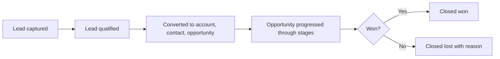

# Business Requirements Document — {Project Name}

<!--
Template rules (delete this comment in the output):
- Keep every numbered section. If a section does not apply, keep the heading and write
  "Not applicable — {reason}".
- Section numbers are fixed so downstream agents can reference them.
- Unknown values: [TBD] plus an open question Q-nn in section 17.
- Items derived rather than stated: suffix [Inferred].
-->

## Document Control

| Item | Details |
|---|---|
| Client | {Client legal name} |
| Implementation partner | {Partner} |
| Project | {Project name} |
| Document reference | BRD-{PROJECTCODE}-{YYYY}-{NNN} |
| Version | {0.1} |
| Date | {YYYY-MM-DD} |
| Status | Draft for review |
| Authors | {Names and roles} |
| Prepared for | {Sponsor and approvers} |

### Version history

| Version | Date | Author | Change summary |
|---|---|---|---|
| 0.1 | {date} | {author} | Initial draft generated from SRC-01..SRC-nn |

---

## 1. Executive Summary

Five to eight sentences: who the client is, the core problem in business terms (with the one or
two numbers that matter), what this phase delivers, the key outcomes expected, and the main open
decisions.

## 2. Business Background

### 2.1 Organisation overview
Business model, size, regions, sales/service channels relevant to the scope.

### 2.2 Current state (As-Is)
Current systems (for example legacy CRM, spreadsheets), how the process runs today, who does what.

### 2.3 Business problems
Bulleted, each with impact and evidence:
- **{Problem}** — {impact, quantified where the sources give a number}. (SRC-nn)

## 3. Business Objectives and Success Metrics

| ID | Objective | KPI | Baseline | Target | Measured by | Source |
|---|---|---|---|---|---|---|
| OBJ-01 | {Objective} | {KPI} | {current value or [TBD]} | {target or [TBD]} | {report / survey} | SRC-nn |

## 4. Scope

### 4.1 In scope
Business processes and capabilities in this phase.

### 4.2 Out of scope
Explicit exclusions, each with a reason where known.

### 4.3 Future phases
Items deliberately deferred.

## 5. Stakeholders and User Personas

### 5.1 Stakeholders

| Name | Role | Organisation | Responsibility in project | Decision rights |
|---|---|---|---|---|
| {Name} | {Title} | {Client / Partner} | {What they own} | Approver / Reviewer / Informed |

### 5.2 User personas

| Persona | Approx. users | Key goals | Pain points | Device / channel | Licence (indicative) |
|---|---|---|---|---|---|
| Sales Representative | {n or [TBD]} | | | Desktop, mobile app | Sales Cloud [Inferred] |

## 6. Business Process Overview

### 6.1 Current process (As-Is)
Short narrative; diagram only if the sources describe it in enough detail.

### 6.2 Future process (To-Be)
Numbered end-to-end steps, followed by a Mermaid flowchart. Keep it business-level (no object or
field names). Use quoted labels.

## 7. Business Requirements Summary

| BR ID | Requirement | Description (one line) | Priority (MoSCoW) | Objective | Source |
|---|---|---|---|---|---|
| BR-01 | {Name} | {Summary} | Must | OBJ-01 | SRC-01, SRC-02 |

Priority key: **Must** (phase fails without it), **Should** (important, workaround exists),
**Could** (desirable), **Won't (this phase)**. Add High/Medium/Low in brackets if the client uses it.

## 8. Detailed Business Requirements

Repeat 8.n for every BR in section 7, in the same order.

### 8.1 BR-01: {Requirement name}

**8.1.1 Description** — what capability the business needs and why (two to four sentences).

**8.1.2 Business scenario** — a short narrative of who does what, when, and what they need to see
or decide. Name the persona.

**8.1.3 Functional requirements**

| ID | Requirement | Priority | Source |
|---|---|---|---|
| FR-01.1 | The system shall … | Must | SRC-01 §2 |

**8.1.4 Business rules**

| ID | Rule | Source |
|---|---|---|
| RULE-01.1 | {Condition -> outcome, in business terms} | SRC-02 ~14:05 |

**8.1.5 Data requirements**

| Data element | Business meaning | Format / allowed values | Mandatory | Source |
|---|---|---|---|---|
| Discount percentage | Discount offered on the deal | Percentage, 0-100 | When discount offered | SRC-01 |

**8.1.6 User interface and experience** — what the user must see and where; accessibility;
mobile. Business-level, not component design.

**8.1.7 Reporting needs** — reports or dashboards this requirement drives.

**8.1.8 Requirement-specific NFRs** — performance, volume, availability for this capability.

**8.1.9 Acceptance criteria (business-level)**
- AC-01.1 {Observable outcome a business user can verify}

**8.1.10 Delivery notes** — stakeholder instructions about how to slice or sequence this item
(for example "deliver as a single story"). The Jira agent honours these.

**8.1.11 Related items** — dependencies, risks, open questions (`D-nn`, `R-nn`, `Q-nn`).

## 9. Non-Functional Requirements

| ID | Category | Requirement | Measure | Source |
|---|---|---|---|---|
| NFR-01 | Performance | Record pages with new components load within the agreed time | ≤ 2 s at P90 [TBD] | SRC-nn |
| NFR-02 | Scalability | Supports the expected user and data volume | {n} users, {n} records/year | |
| NFR-03 | Availability | | | |
| NFR-04 | Security | | | |
| NFR-05 | Privacy and compliance | GDPR / DPDP / HIPAA etc. as applicable | | |
| NFR-06 | Accessibility | WCAG 2.1 AA for custom UI | | |
| NFR-07 | Usability and adoption | | | |
| NFR-08 | Audit and history | | | |
| NFR-09 | Data retention | | | |
| NFR-10 | Localisation | languages, currencies, time zones | | |

## 10. Data and Integration Requirements

### 10.1 Data volumes
| Entity (business term) | Current volume | Annual growth | Source |
|---|---|---|---|

### 10.2 Data migration
Sources, scope (what history), cleansing and de-duplication expectations, cut-over constraints.

### 10.3 Integrations
| ID | External system | Direction | Business data | Trigger / frequency | Latency need | Source |
|---|---|---|---|---|---|---|
| INT-01 | {System} | Inbound / Outbound / Both | | | | |

## 11. Reporting and Analytics
Reports, dashboards and KPIs per persona; refresh expectations; who consumes them.

## 12. Security, Access and Compliance
| Persona | Should see | Should edit | Must not see | Source |
|---|---|---|---|---|

Data sensitivity classification, audit needs, regulatory constraints.

## 13. Assumptions
| ID | Assumption | Impact if false | Owner to validate |
|---|---|---|---|
| A-01 | | | |

## 14. Constraints
| ID | Constraint (budget, timeline, licences, technology, regulation) |
|---|---|
| C-01 | |

## 15. Dependencies
| ID | Dependency | On whom | Needed by |
|---|---|---|---|
| D-01 | | | |

## 16. Risks and Mitigation
| ID | Risk | Likelihood | Impact | Mitigation | Owner |
|---|---|---|---|---|---|
| R-01 | | Low/Med/High | Low/Med/High | | |

## 17. Open Questions
| ID | Question | Why it matters (affected IDs) | Raised from | Ask | Status |
|---|---|---|---|---|---|
| Q-01 | | BR-03, FR-03.2 | SRC-02 ~22:10 | {stakeholder} | Open |

## 18. Glossary
| Term | Definition |
|---|---|

## 19. Approval and Sign-off
| Name | Role | Decision | Date | Signature / comment |
|---|---|---|---|---|
| | Business sponsor | | | |
| | Process owner | | | |
| | Implementation lead | | | |

---

## Appendix A. Requirements traceability
| BR | Objectives | FRs | Rules | Sources |
|---|---|---|---|---|
| BR-01 | OBJ-01, OBJ-05 | FR-01.1–FR-01.4 | RULE-01.1 | SRC-01, SRC-03 |

## Appendix B. Source register
| ID | Document | Type | Date | Author / participants |
|---|---|---|---|---|
| SRC-01 | Meeting Notes.md | Workshop notes | {date} | {author} |

## Appendix C. Salesforce capability fit (indicative, not a design)
| BR / FR | Likely Salesforce capability | Fit | Notes / feasibility flags |
|---|---|---|---|
| FR-04.2 | Formula or scheduled recalculation | Custom code / Declarative | F2: date-based score goes stale if stored — see Q-05 |

Fit values: Standard · Configuration · Declarative automation · Custom code · AppExchange ·
Out of platform. The Solution Architecture agent confirms or changes these.
