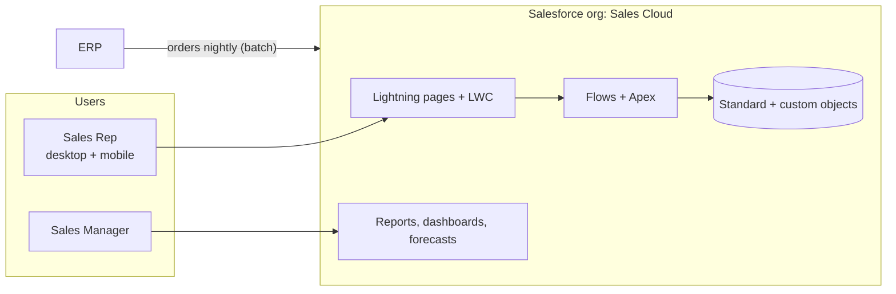
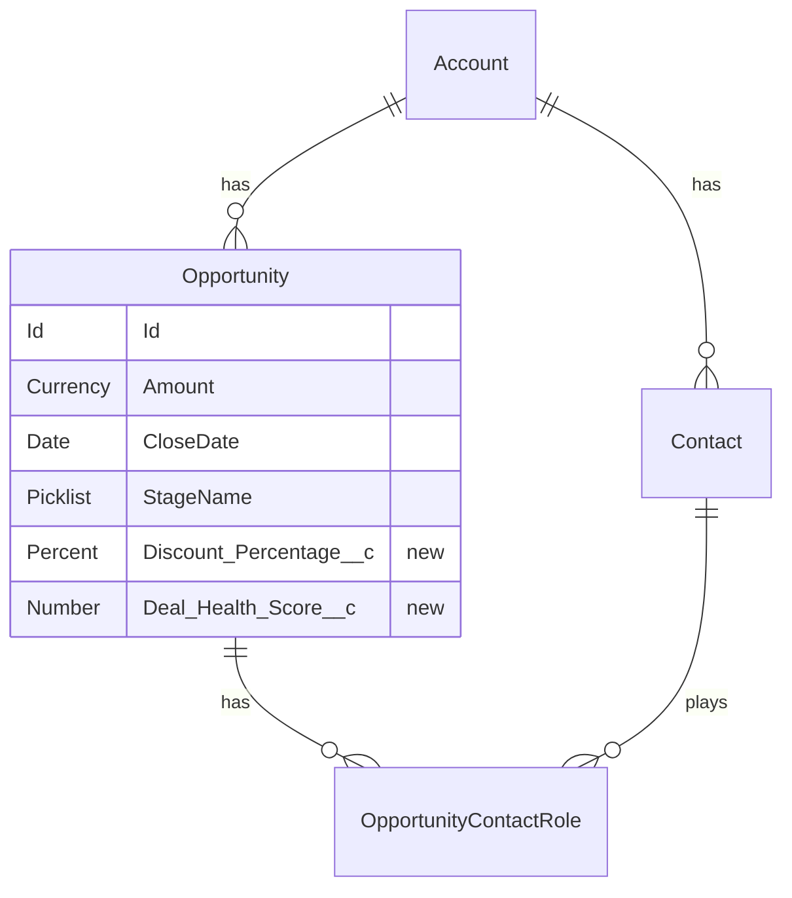
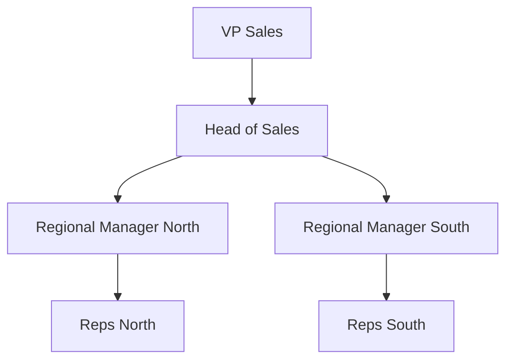
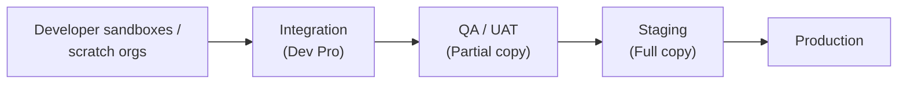

# High-Level Solution Design — {Project} {Release}

| Item | Details |
|---|---|
| Document reference | HLD-{PROJECTCODE}-{NNN} |
| Version / date | {0.1} / {YYYY-MM-DD} |
| Status | Draft for technical review |
| Inputs | BRD v{x.y}, backlog {date}, existing repo `{path}` @ `{commit}` |
| Authors / reviewers | {names} |

## 1. Purpose and scope
What this design covers (BRs, epics, release) and what it does not.

## 2. Architecture drivers
| Driver | Source | Design implication |
|---|---|---|
| Real-time pipeline visibility | OBJ-01 | Standard reports and Collaborative Forecasts; no external BI in phase 1 |
| 500 concurrent users, page load ≤ 2 s | NFR-01/02 | Cacheable Apex, LDS, no SOQL in loops, lazy-load panels |

Constraints (`C-nn`) and assumptions (`A-nn`) that shape the design.

## 3. Architecture principles
- Standard before custom; configuration before declarative; declarative before code — unless the
  decision guide says code is the better long-term choice.
- One automation entry point per object and event (one trigger + handler; flows ordered).
- Security by default: `with sharing`, `WITH USER_MODE` / `AccessLevel.USER_MODE`, permission
  sets (not profiles) for access.
- Configuration in Custom Metadata, not hard-coded values.
- Integrations through Named Credentials and External Credentials; no secrets in code.
- Everything in source control and deployed by pipeline.
{Add client-specific principles.}

## 4. Solution overview
Narrative (one paragraph) plus the system landscape.

## 5. Org and product footprint
| Item | Value |
|---|---|
| Edition, clouds | |
| Licences per persona | |
| Features to enable | Account Hierarchy, Path, Collaborative Forecasts, … |
| API version | |
| Org strategy | Single org / multi-org; new / existing |

## 6. Capability map (BR → platform)
| BR / FR | Capability | Approach | Components | ADR |
|---|---|---|---|---|
| BR-04 / FR-04.2 | Health score | Apex service + nightly batch | `OpportunityHealthService`, `OpportunityHealthBatch` | ADR-002 |

Approach values: Standard · Configuration · Flow · Apex · LWC · Integration · AppExchange.

## 7. Data architecture
### 7.1 Data model

### 7.2 Object inventory
| Object | Standard / custom | Purpose | Owner/sharing driver | Est. volume |
|---|---|---|---|---|

### 7.3 Data volumes, LDV, archiving
### 7.4 Data migration approach
Sources, sequence (users → accounts → contacts → opportunities …), tooling, de-duplication,
automation bypass during load, reconciliation.

## 8. Security and access
- OWD per object, with reason.
- Role hierarchy:

- Permission set groups per persona; custom permissions; FLS for sensitive fields.
- Sharing rules, teams, restriction rules.
- Authentication (SSO/MFA), session settings, Shield/encryption if required.

## 9. Automation architecture
| Object | Event | Mechanism (order) | Purpose | Story |
|---|---|---|---|---|
| Opportunity | before save | Flow `Opp_BeforeSave_Defaults` (1) | defaults | US-03-02 |
| Opportunity | after save | Trigger → `OpportunityTriggerHandler` | score recalculation | US-04-02 |
| Opportunity | scheduled nightly | `OpportunityHealthBatch` | time-based factors | US-04-02 |

Trigger framework: {existing / proposed}. Recursion control. Error handling and logging approach.

## 10. Integration architecture
| ID | System | Direction | Pattern | Mechanism | Volume / frequency | Error handling |
|---|---|---|---|---|---|---|
| INT-01 | ERP | Inbound | Batch data synchronisation | Bulk API 2.0 via middleware | 5k/day nightly | Error object + alert |

Sequence diagram per non-trivial interface (see mermaid-patterns.md).

## 11. User interface
Lightning apps, record pages, components per page; LWC component tree for custom UI; mobile.

## 12. Reporting and analytics
Report types, key reports and dashboards per persona, forecast configuration.

## 13. Non-functional design
| NFR | How the design meets it | Verification |
|---|---|---|
| NFR-01 page load | single cacheable Apex call; no SOQL in loops | QA perf test TC-… |

Governor-limit risks and mitigations.

## 14. Environments and DevOps

Branching model, CI checks (Code Analyzer, Apex tests, Jest), deployment tool (sf CLI / DevOps
Center), release cadence, post-deploy manual steps register.

## 15. Risks, technical debt and decisions
| ID | Item | Mitigation / decision |
|---|---|---|
| ADR-001 | {title} | {status} |

## 16. Story-to-design map
| Story | Components (API names) | LLD | Notes |
|---|---|---|---|
| US-04-02 | `OpportunityHealthService`, `OpportunityHealthBatch`, `OpportunityTrigger` | LLD-US-04-02 | ADR-002 |
| US-02-03 | Account Hierarchy, Lightning page | — | Configuration only |

## 17. Open items
Questions for the client or tech lead, each with owner.
