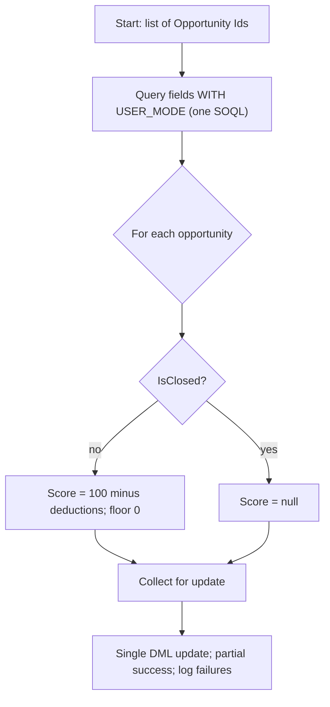
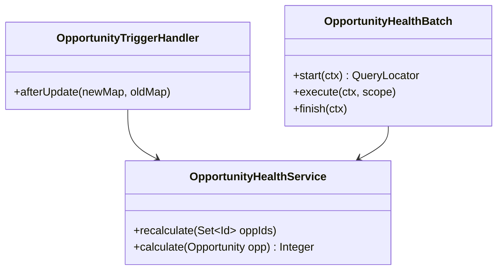
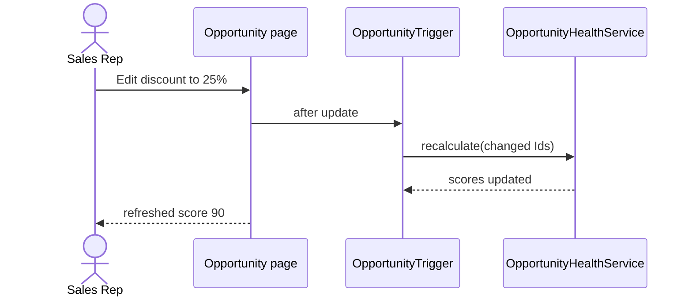

# LLD-US-{nn-mm}: {Story title}

| Item | Details |
|---|---|
| Story | US-{nn-mm} ({Jira key}) — Source BR-{nn} / FR-{nn.m} |
| HLD | HLD §{n} |
| ADRs | {ADR-nnn} |
| Status | Draft for tech-lead review |

## 1. Summary
Two to four sentences: what changes and the chosen approach. Alternatives considered and why
rejected (one line each).

## 2. Acceptance criteria → design
| AC | Satisfied by | Verified by |
|---|---|---|
| AC-1 | `OpportunityHealthService.calculate()` base score | Apex test `calculate_noRisks_returns100` |
| AC-6 | `OpportunityHealthBatch` (scope 200) | Apex test `batch_10kRecords` + QA TC-…-012 |

## 3. Metadata inventory
| # | Type | API name | Action | Notes |
|---|---|---|---|---|
| 1 | CustomField | `Opportunity.Deal_Health_Score__c` | New | Number(3,0) |
| 2 | ApexClass | `OpportunityHealthService` | New | |
| 3 | ApexClass | `OpportunityHealthServiceTest` | New | |
| 4 | ApexTrigger | `OpportunityTrigger` | Modify | add handler call |
| 5 | PermissionSet | `Sales_Manager_Access` | Modify | FLS read on new field |

Deployment order follows the table order.

## 4. Data model changes
| Object | Field label | API name | Type | Length/precision | Default | Required | Help text | FLS (read/edit) |
|---|---|---|---|---|---|---|---|---|

Picklist values, record types, validation rules (with formula and exact error message and location).

## 5. Logic design
Business logic as pseudo-code or a flowchart. Name entry points.

### 5.1 Declarative components
Flow name, type, trigger, entry conditions, elements, fault paths.

### 5.2 Apex design

Method signatures, sharing keyword, inputs/outputs, exceptions thrown.

### 5.3 LWC design
Component tree, `@api` properties, wire adapters / Apex methods (cacheable?), events, states
(loading, empty, error), SLDS blueprint, accessibility notes, Lightning page placement and
targets in `js-meta.xml`.

## 6. Interaction

## 7. Security
Sharing keyword and reason; CRUD/FLS enforcement (`WITH USER_MODE`, `stripInaccessible`);
permission sets/custom permissions touched; data exposed in the UI by persona.

## 8. Governor limits and performance
| Path | SOQL | DML | Rows | CPU risk | Notes |
|---|---|---|---|---|---|
| Trigger (200 records) | 1 | 1 | 200 | Low | no SOQL in loop |
| Batch execute (scope 200) | 1 | 1 | 200 | Low | |

Large data volume considerations, selective queries, async limits.

## 9. Error handling and logging
What can fail, what the user sees, what is logged where, retry behaviour.

## 10. Test design (developer level)
| Test class / file | Method / test | Covers |
|---|---|---|
| `OpportunityHealthServiceTest` | `calculate_overdue_deducts20` | AC-2 |
| `OpportunityHealthServiceTest` | `recalculate_bulk200_noLimitErrors` | NFR-02 |
| `healthPanel.test.js` | renders amber band for 60 | AC-… |

Test data approach (TestDataFactory), personas (`System.runAs`), mocks.

## 11. Deployment notes
Pre- and post-deployment manual steps (feature enablement, data backfill, scheduling the batch,
permission set assignment), rollback approach, destructive changes.

## 12. Open issues
Questions, assumptions made in the design, and deviations from the story (to be raised to the PO).
