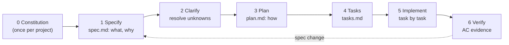

# sdlc-spec-driven-development

Coding agents write good code when they are told precisely what to build and how it must fit the
project. They write plausible but wrong code when they guess. SDD removes the guessing:



Each phase writes one file and **stops for review**. Do not run the next phase in the same turn
unless the user explicitly says so ("go through to tasks").

## When to use it
- Any Jira story, any change touching more than one metadata type, any Apex/LWC/Flow logic,
  integrations, security changes.
- Skip for trivial changes: typo, label, single field help text, formatting. Say "trivial change,
  skipping spec" and proceed.

## Files

```text
specs/
├── constitution.md                    # phase 0, shared by all features
└── US-04-02-deal-health-score/        # feature folder: story ID (or NNN) + slug
    ├── spec.md                        # phase 1-2
    ├── plan.md                        # phase 3
    ├── tasks.md                       # phase 4, checked off in phase 5
    └── verification.md                # phase 6
```

Folder naming: use the story ID when there is one (`US-04-02-…`); otherwise the next free
three-digit number (`007-…`). Slug: 2-5 lowercase words.

## Phase 0 — Constitution (`/sdd-constitution`)
If `specs/constitution.md` is missing, create it from
[references/constitution-template.md](references/constitution-template.md). Detect project
facts first (API version from `sfdx-project.json`, trigger framework, naming prefixes, test
coverage target, logging utility) and fill them in; ask only for what cannot be detected. If the
project has a `CLAUDE.md`, `AGENTS.md`, copilot instructions or Cursor rules, align with them.

## Phase 1 — Specify (`/sdd-specify <story id | description>`)
1. Find the source: Jira story in `docs/sdlc/02-backlog/backlog.md`, a Jira key via a connected
   tool, or the user's description.
2. Create the feature folder and write `spec.md` from
   [references/spec-template.md](references/spec-template.md).
3. The spec is **what and why only**: scenarios, functional requirements, business rules, data
   (business terms), acceptance scenarios, success criteria, out of scope. No class names, no
   field API names, no flow names.
4. Copy story ACs verbatim as the acceptance scenarios and keep their `AC-n` numbers.
5. Mark unknowns `[NEEDS CLARIFICATION: question]`. At most 5; make reasonable defaults for the
   rest and list them under Assumptions.
6. Run the spec checklist at the bottom of the template. Stop and show the open clarifications.

## Phase 2 — Clarify (`/sdd-clarify`)
Ask the user the `[NEEDS CLARIFICATION]` questions one at a time, each with 2-4 concrete options and
a recommendation. Write each answer into the spec (Clarifications section with date) and remove the
marker. Stop when none remain or the user says to proceed with the assumptions.

## Phase 3 — Plan (`/sdd-plan`)
1. Refuse to plan while `[NEEDS CLARIFICATION]` markers remain, unless the user accepts the risk
   (record it in the plan).
2. Read the constitution, the spec, the LLD (`docs/sdlc/03-architecture/LLD/<story>.md`) if it
   exists, and the existing code that will change.
3. Write `plan.md` from [references/plan-template.md](references/plan-template.md):
   technical context, constitution check (each principle: pass / justified exception),
   metadata inventory with exact API names, design per component, test plan, deployment.
4. If an LLD exists, reference it and only record deviations with reasons. Do not re-design.
5. Name which skills implementation will use (for example `platform-apex-generate`,
   `experience-lwc-generate`, `automation-flow-generate`, `platform-custom-field-generate`,
   `platform-permission-set-generate`, `platform-apex-test-generate`).

## Phase 4 — Tasks (`/sdd-tasks`)
Write `tasks.md` from [references/tasks-template.md](references/tasks-template.md):
- Ordered by metadata dependency: objects/fields → custom metadata/labels → permission sets →
  Apex (tests first) → triggers → flows → LWC (Jest first) → pages/layouts → data/scripts.
- Each task: ID `T001…`, the files it touches, the AC(s) it serves, `[P]` if it can run in
  parallel with the previous task (different files, no dependency).
- Test tasks precede the implementation they verify (red → green).
- Include a verification task per AC and a final quality-gate task.

## Phase 5 — Implement (`/sdd-implement [task range]`)
- Work task by task in order. Before each task, re-read its line in `tasks.md` and the matching
  plan section. Use the skill named in the plan.
- After each task: run the narrowest useful check (deploy dry-run of the changed metadata, the
  related Apex test, Jest test, Code Analyzer on changed files), then tick `[x]` and append a
  one-line note (file paths, test result).
- Stop and ask when the plan turns out wrong; update the plan (with a "Changed during
  implementation" note) before continuing. Never silently diverge from the spec.
- Do not deploy to shared orgs or production. Validate-only deploys to a target org only when the
  user names the org.

## Phase 6 — Verify (`/sdd-verify`)
Write `verification.md`:
- Each AC → evidence (test name and result, screenshot reference, or manual step outcome).
- Quality gates: all tests pass; coverage of new/changed classes (target from the constitution);
  Code Analyzer (no new high/critical); security review of the diff (sharing, CRUD/FLS, injection,
  secrets); constitution check re-run.
- Deviations from spec/plan and their approval.
- Hand-off: link test cases (`docs/sdlc/04-qa/test-cases/<story>.md`) or suggest running the
  `sdlc-qa-test-agent`.
Set `spec.md` status to `Implemented — pending review`.

## Rules for every phase
- Read before write: the constitution and the previous phase's file every time.
- Keep files short and specific; delete template sections that do not apply (write "N/A — reason"
  for mandatory ones).
- One feature per folder. A scope change goes back to the spec, not straight into code.
