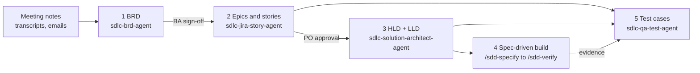

# sdlc-workflow: the Salesforce SDLC pipeline

Four agents and one development method form a pipeline. Each stage reads the previous stage's
artifact from disk, so stages can run in separate sessions, by different people, on different
coding agents (Claude Code, GitHub Copilot, Cursor).



| # | Stage | Agent / entry point | Skill | Reads | Writes |
|---|---|---|---|---|---|
| 1 | Requirements | `sdlc-brd-agent` | `sdlc-brd-generate` | `docs/sdlc/00-inputs/*` | `docs/sdlc/01-brd/BRD.md` |
| 2 | Backlog | `sdlc-jira-story-agent` | `sdlc-jira-story-generate` | BRD | `docs/sdlc/02-backlog/backlog.md`, `jira-import.csv` |
| 3 | Design | `sdlc-solution-architect-agent` | `sdlc-solution-architecture-generate` | BRD, backlog | `docs/sdlc/03-architecture/HLD.md`, `LLD/US-*.md`, `ADR/*.md` |
| 4 | Build | `/sdd-specify`, `/sdd-plan`, `/sdd-tasks`, `/sdd-implement`, `/sdd-verify` | `sdlc-spec-driven-development` | story + LLD | `specs/<id>-<slug>/spec.md`, `plan.md`, `tasks.md`, code |
| 5 | Test design | `sdlc-qa-test-agent` | `sdlc-qa-test-case-generate` | backlog, LLD, spec | `docs/sdlc/04-qa/test-cases/US-*.md`, `test-cases.csv`, `rtm.md` |

Every stage ends with a **human gate**: the agent writes a draft, lists open questions, and stops.
The next stage starts only after a person reviews the artifact. Agents never mark their own output
as approved.

## Artifact layout (in the Salesforce project that uses this kit)

```text
docs/sdlc/
├── 00-inputs/            raw meeting notes, transcripts, emails (as supplied, never edited)
├── 01-brd/BRD.md         Business Requirements Document
├── 02-backlog/
│   ├── backlog.md        epics, stories, dependency graph, release slicing
│   └── jira-import.csv   Jira CSV import file
├── 03-architecture/
│   ├── HLD.md            high-level solution architecture
│   ├── LLD/US-04-02.md   one low-level design per story
│   └── ADR/ADR-001-*.md  architecture decision records
└── 04-qa/
    ├── test-strategy.md
    ├── test-cases/US-04-02.md
    ├── test-cases.csv    Xray / Zephyr / TestRail import
    └── rtm.md            requirements traceability matrix
specs/
├── constitution.md       project engineering principles (spec-driven development)
└── US-04-02-deal-health-score/
    ├── spec.md  plan.md  tasks.md
```

If the project already uses different folders, follow the project and say so in the output.

## Traceability IDs

Use these IDs exactly. They are the glue between artifacts; downstream agents parse them.

| ID | Meaning | Defined in | Example |
|---|---|---|---|
| `SRC-nn` | Source document (notes, transcript, email) | BRD Appendix B | `SRC-02` |
| `OBJ-nn` | Business objective | BRD section 3 | `OBJ-03` |
| `BR-nn` | Business requirement (capability) | BRD section 7 | `BR-04` |
| `FR-nn.m` | Functional requirement under `BR-nn` | BRD section 8 | `FR-04.2` |
| `RULE-nn.m` | Business rule under `BR-nn` | BRD section 8 | `RULE-03.1` |
| `NFR-nn` | Non-functional requirement | BRD section 9 | `NFR-02` |
| `A-nn` / `C-nn` / `D-nn` / `R-nn` / `Q-nn` | Assumption / constraint / dependency / risk / open question | BRD 13-17 | `Q-04` |
| `EPIC-nn` | Jira epic; `nn` matches the BR it delivers where 1:1 | backlog | `EPIC-04` |
| `US-nn-mm` | Story `mm` in `EPIC-nn` | backlog | `US-04-02` |
| `AC-n` | Acceptance criterion inside a story | backlog | `US-04-02 AC-3` |
| `ADR-nnn` | Architecture decision | `ADR/` | `ADR-002` |
| `LLD-US-nn-mm` | Low-level design for a story | `LLD/` | `LLD-US-04-02` |
| `TC-US-nn-mm-nnn` | Test case for a story | QA | `TC-US-04-02-007` |

Rules:
- IDs are never reused or renumbered after a stage is approved. Deleted items stay as
  `~~BR-06~~ (withdrawn, see Q-03)`.
- Every downstream item names its upstream ID (`Source: BR-04 / FR-04.2`). An item with no
  upstream ID is either a technical enabler (say so) or scope creep (flag it).
- When the Jira tool assigns real keys (`ORION-123`), keep the `US-nn-mm` ID in the summary prefix
  or a label so the trace survives.

## Traceability matrix

[references/traceability-matrix.md](references/traceability-matrix.md) has the RTM format. Any
agent asked for "traceability" or "coverage" builds it from the IDs above and reports gaps:
BRs without stories, stories without LLD, ACs without test cases.

## Salesforce feasibility checklist

Requirements and stories often ask for behaviour Salesforce does not provide out of the box.
Every agent from stage 2 onward runs
[references/salesforce-feasibility-checklist.md](references/salesforce-feasibility-checklist.md)
against what it produces and records each hit as a note, an assumption or an open question. It is
cheaper to catch "validation rule as a warning" in the backlog than in UAT.

## Running end to end

When asked to "run the whole SDLC":
1. Confirm the inputs and the project code (used in file names and the Jira epic prefix).
2. Run stage 1. Stop for review. Do not auto-approve.
3. On the user's go-ahead, run each next stage, one per turn, stopping at each gate.
4. Finish with the RTM and the list of unresolved `Q-nn` items.

On a platform with subagents, run each stage in its own agent so its context stays small. Pass
file paths, not file contents, between stages.
