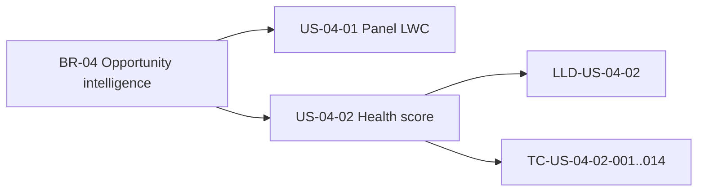

# Requirements Traceability Matrix (RTM)

Build the RTM from IDs only; never re-derive requirements. Save to `docs/sdlc/04-qa/rtm.md`
(or wherever the user asks).

## Forward trace (requirement -> delivery -> verification)

| BR | FR / RULE | Story | AC | LLD | Test cases | Status |
|---|---|---|---|---|---|---|
| BR-04 | FR-04.2 | US-04-02 | AC-1..AC-6 | LLD-US-04-02 | TC-US-04-02-001..014 | Covered |
| BR-04 | FR-04.5 | US-04-05 | AC-1..AC-4 | LLD-US-04-05 | — | **Gap: no tests** |
| BR-05 | FR-05.3 | — | — | — | — | **Gap: no story** |

Status values: `Covered`, `Partial` (some ACs have no test), `Gap: no story`,
`Gap: no design`, `Gap: no tests`, `Deferred` (with the decision reference).

## Backward trace (find scope creep)

| Item | Upstream ID | Verdict |
|---|---|---|
| US-03-06 | — | Technical enabler: permission set group (allowed) |
| US-04-07 | — | **No source requirement: confirm with PO** |

## Coverage summary

```text
BRs: 5   with stories: 5 (100%)
FRs: 21  with stories: 20 (95%)   missing: FR-05.3
Stories: 18  with LLD: 12 (67%)  with tests: 15 (83%)
ACs: 104  with at least one test case: 97 (93%)
Open questions affecting scope: Q-02, Q-05
```

## Mermaid view (optional, small scopes only)

Use only when there are fewer than ~25 nodes; large graphs do not render legibly.


