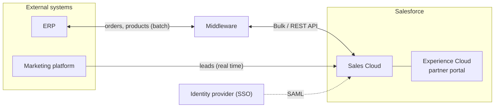
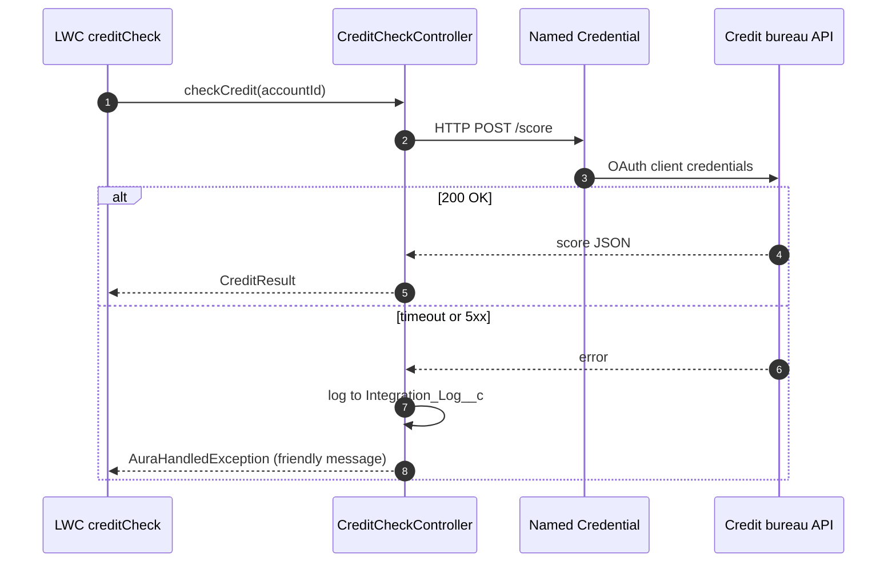
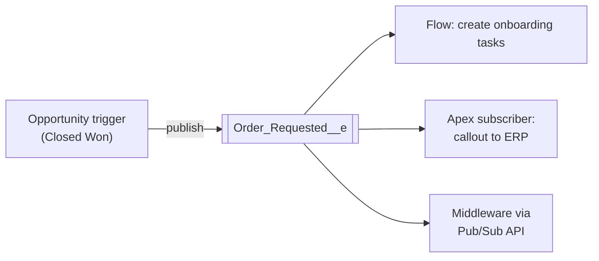
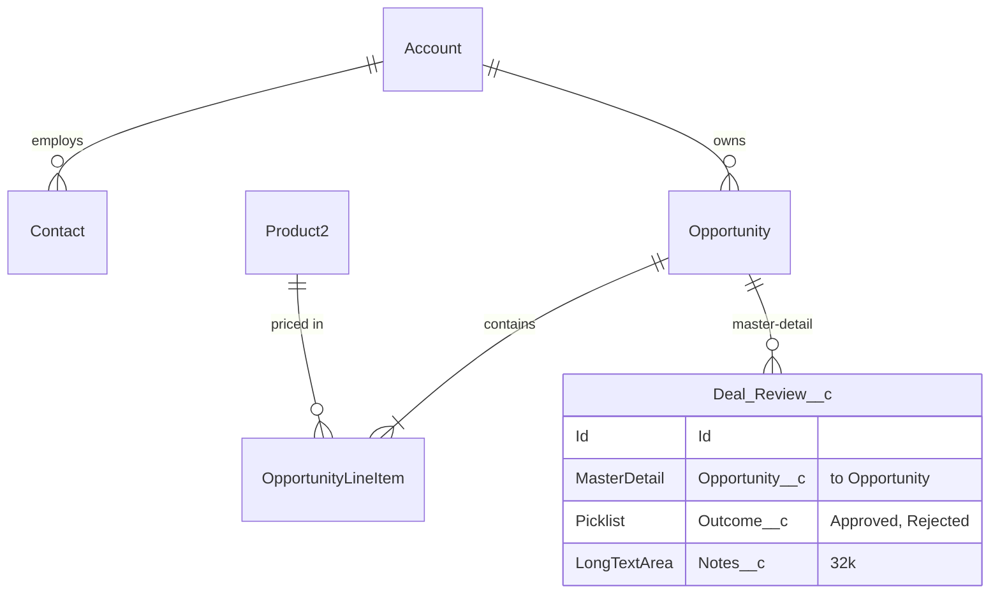
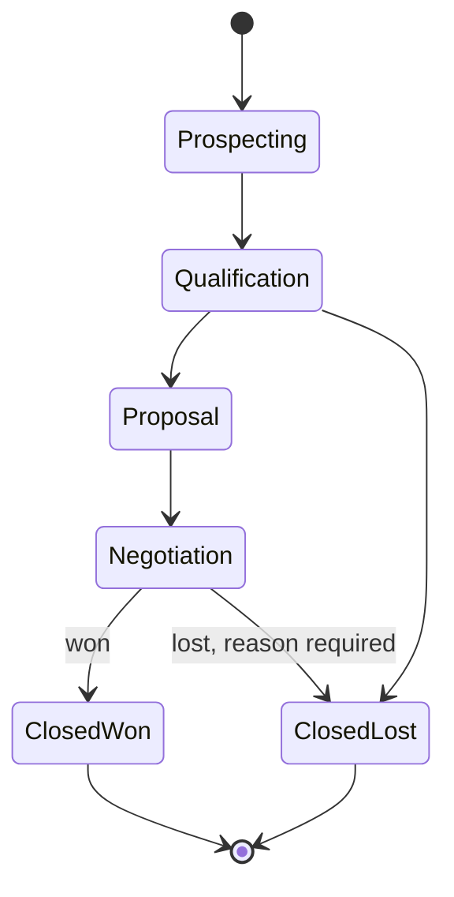
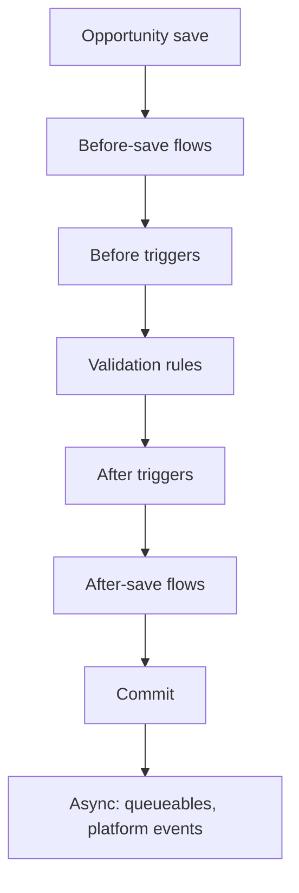
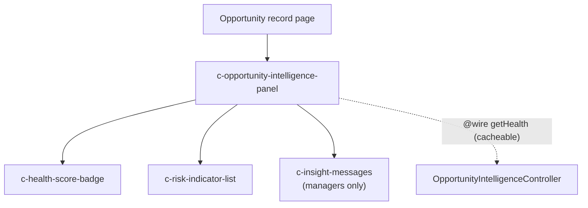
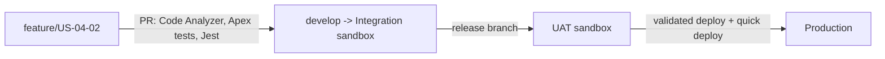
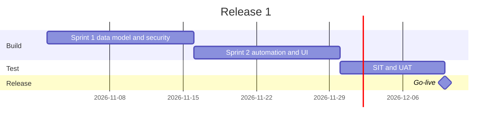

# Mermaid patterns for Salesforce architecture

Copy and adapt. All patterns use diagram types that render on common Git hosts, wikis and editor
previews.

These patterns show structure only. Any diagram that shows components of the solution must also
show what is New, Changed, Unchanged and Removed: for that, use the `sdlc-architecture-diagram`
skill and its templates (`.claude/skills/sdlc-architecture-diagram/references/diagram-templates.md`),
which add the status classes, label prefixes and the Key to patterns 1, 3, 4, 6 and 7. Patterns 2
(sequence), 5 (state), 8 (pipeline) and 9 (timeline) carry status through label prefixes only,
or not at all.

## Syntax rules that avoid broken renders
- Quote labels with spaces, parentheses, slashes, colons or `#`: `A["Apex (async)"]`.
- Node IDs: letters and digits only (`US0402`, not `US-04-02`). Put the readable ID in the label.
- Do not use `end` as a node ID (it closes subgraphs).
- Line breaks inside labels: ` `.
- Edge labels: `A -->|"label"| B` (flowchart) or `A -- "label" --> B`.
- `erDiagram` attribute lines are `type name "comment"`; types cannot contain spaces or
  parentheses (`Number`, not `Number(3,0)`). Put precision in the comment.
- Keep each diagram under ~25 nodes.

## 1. System landscape (Level 1: what talks to what)

## 2. Integration sequence (request and reply with error path)

## 3. Event-driven (Platform Event fan-out)

## 4. Data model (ERD)

Cardinality: `||--o{` one to many (optional), `||--|{` one to many (required), `}o--o{` many to
many (show the junction object explicitly in Salesforce).

## 5. Status lifecycle

## 6. Automation order on one object

## 7. LWC component tree

## 8. Deployment pipeline

## 9. Release timeline

