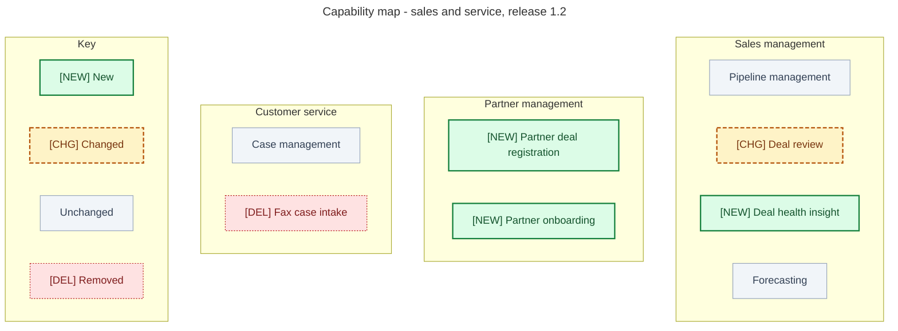
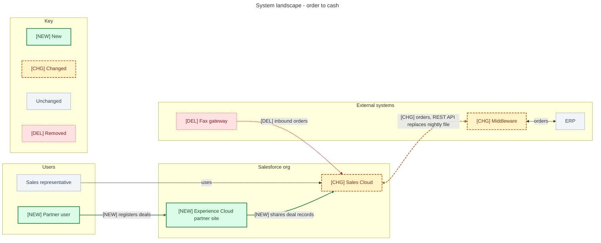
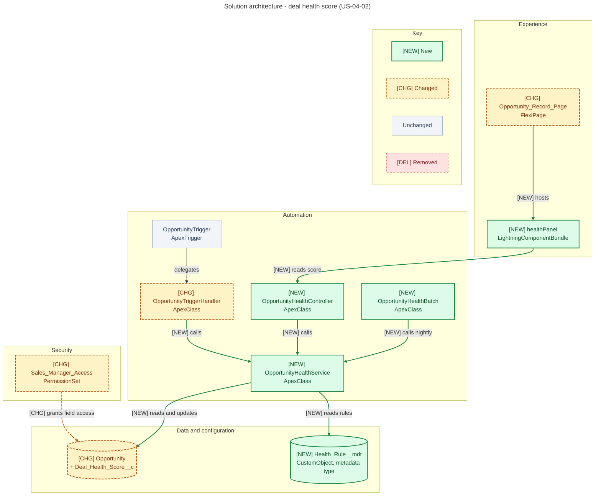
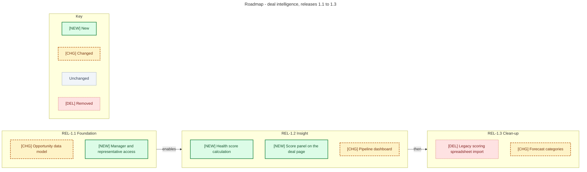
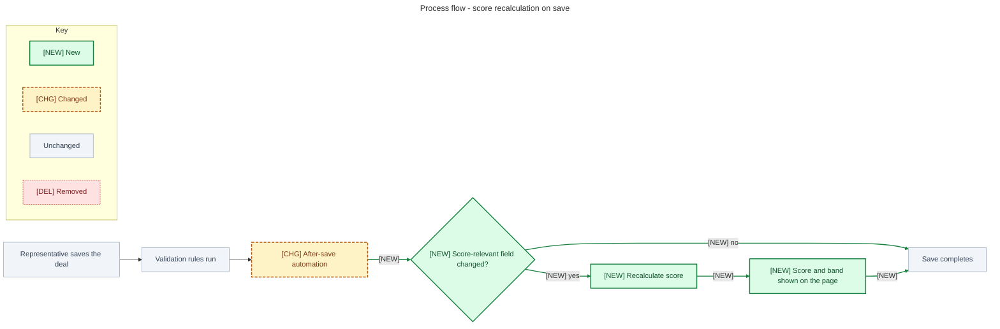
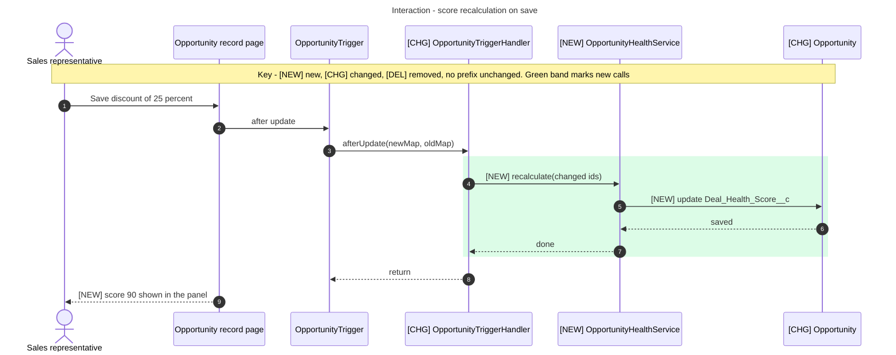
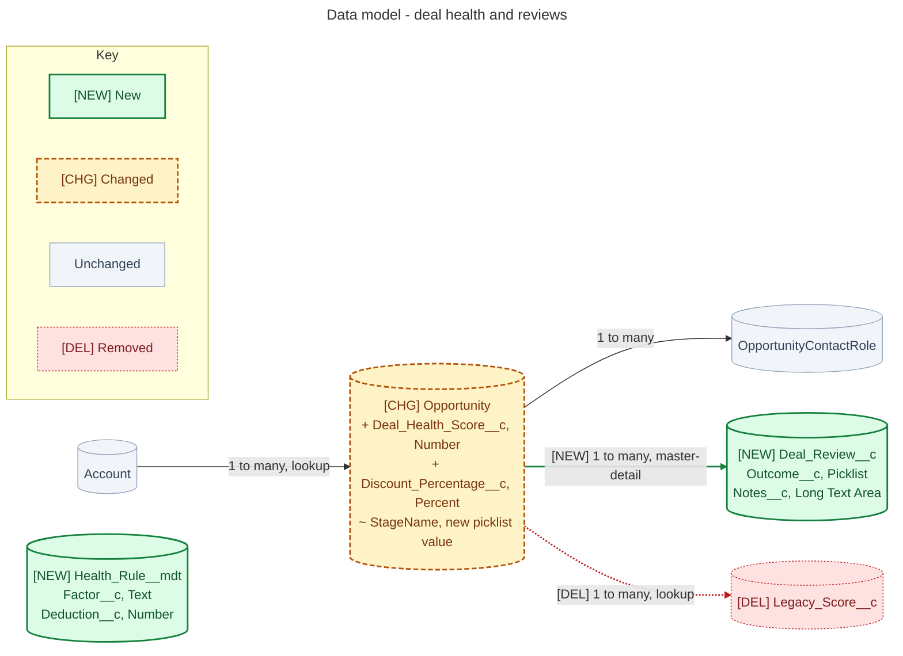

# Diagram templates with the change-status overlay

One worked example per Salesforce diagram type. Copy, then replace every node from
`components.json`; the names below are illustrative. Each template has: a title (front matter),
`accTitle` / `accDescr`, one flow direction, one status class per node, label prefixes, the Key
subgraph, and the `classDef` / `linkStyle` lines at the end.

If a renderer rejects the front-matter block (the three lines `---`, `title:`, `---`), delete
those lines and keep the Markdown heading and caption.

Edge numbering for `linkStyle` starts at 0 and follows the order in which edges are written.
Each template lists its edge numbers in a comment so they can be recounted after an edit.

## The shared tail (identical in every flowchart)

```text
    subgraph KEY["Key"]
        direction LR
        K1["[NEW] New"]:::new
        K2["[CHG] Changed"]:::changed
        K3["Unchanged"]:::unchanged
        K4["[DEL] Removed"]:::removed
    end
    classDef new fill:#dcfce7,stroke:#15803d,stroke-width:2px,color:#14532d
    classDef changed fill:#fef3c7,stroke:#b45309,stroke-width:2px,stroke-dasharray:6 3,color:#78350f
    classDef unchanged fill:#f1f5f9,stroke:#94a3b8,color:#334155
    classDef removed fill:#fee2e2,stroke:#b91c1c,stroke-dasharray:2 2,color:#7f1d1d
```

Line styles for edges (append after the `classDef` lines, one line per status used):

```text
    linkStyle 1,2 stroke:#15803d,stroke-width:2px
    linkStyle 3 stroke:#b45309,stroke-width:2px,stroke-dasharray:6 3
    linkStyle 5 stroke:#b91c1c,stroke-width:2px,stroke-dasharray:2 2
```

---

## 1. Capability map

Question: which business capabilities does this release add, improve or retire? Nodes are
capabilities in business language; no API names. No edges.



*Caption: release 1.2 adds deal health insight and partner management, improves deal review and
retires fax case intake.*

---

## 2. System landscape

Question: which systems take part and which data flows are added, changed or retired?



*Caption: partners reach Sales Cloud through a new site; the ERP interface moves from a nightly
file to a REST API; the fax gateway is retired. Lines use the same colours and prefixes as the
cards.*

---

## 3. Solution architecture

Question: which metadata components deliver US-04-02 and what do they depend on? One subgraph
per layer; nodes carry the API name and, on a second line, the metadata type.



*Caption: the score is calculated by one new service, called from the existing trigger handler,
a new nightly batch and a new panel on the existing Opportunity page. `OpportunityTrigger` was
checked in the inventory and does not change.*

For a mixed audience (the plan's section 5), reduce this to entry points, component, class with
its test class, and objects: about 10 nodes, no metadata type line.

---

## 4. Roadmap

Question: in which release does each change land? One subgraph per release, in time order.
Status is relative to the state before the first release shown. For dates and durations with no
status, use a `gantt` (pattern 9 in
`.claude/skills/sdlc-architecture-diagram/references/design/mermaid-patterns.md`).



*Caption: the data model and access land first, insight features second, and the legacy import
is retired only after the score has run for one release.*

---

## 5. Interaction, process or flow

### 5a. Process flow (business steps, `flowchart`)

Question: what changes in the path from saving a deal to seeing its score?



### 5b. Interaction (who calls whom, `sequenceDiagram`)

`sequenceDiagram` has no classes. Status is carried by the prefix on participants and messages,
a `rect` in the status fill around new or changed interactions, and a `Note over` line as the Key.



*Caption: the existing trigger and page are untouched; the handler gains one call to a new
service that writes the new score field.*

`rect` fills: new `rgb(220, 252, 231)`, changed `rgb(254, 243, 199)`, removed `rgb(254, 226, 226)`.

---

## 6. Data model

Question: which objects, relationships and fields does this change add, alter or delete? Use
`flowchart` so status can be shown. Changed objects list only the fields that change, prefixed
`+` (added), `~` (altered) or `-` (deleted). Relationship type and cardinality go in the edge
label; the arrow points from parent to child.



*Caption: Opportunity gains two fields and one picklist value; deal reviews are a new child
object; the legacy score object is deleted (destructive change, data export required first).
`Health_Rule__mdt` holds configuration and has no relationship to the other objects.*

For a full attribute listing with no status, use `erDiagram` (pattern 4 in
`.claude/skills/sdlc-architecture-diagram/references/design/mermaid-patterns.md`) next to
this diagram, not instead of it.
