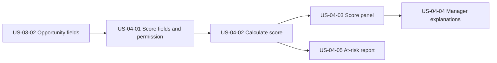

# Backlog — {Project}

| Item | Details |
|---|---|
| Source BRD | `docs/sdlc/01-brd/BRD.md` v{x.y} ({approval status}) |
| Generated | {YYYY-MM-DD} |
| Jira site / project | {jira.site} / {jira.projectKey} from the project config, or "Jira not enabled" |
| Status | Draft for PO review |

## 1. Summary

| Epic | Name | Source BR | Stories | Points | Priority | Jira key |
|---|---|---|---|---|---|---|
| EPIC-01 | {Project} - {Capability} | BR-01 | 3 | 8 | Must | — |

Totals: {n} epics, {n} stories, {n} points. Stories not ready: {n}. In Jira: {n} of {n}.

`Jira key` stays `—` until the issue exists. Keys are written here only from a tool response or
from the user; never invented.

## 2. Requirement coverage

| BR | FR | Stories | Covered |
|---|---|---|---|
| BR-04 | FR-04.1 | US-04-03 | Yes |
| BR-04 | FR-04.7 | — | **No — blocked by Q-05** |

## 3. Epics

### EPIC-04: {Project} - Opportunity Intelligence
- **Source**: BR-04
- **Goal**: {business outcome, one or two sentences}
- **Success measure**: {from BRD objective}
- **In scope / out of scope**: {short}
- **Stories**: US-04-01 … US-04-05

## 4. Stories
{One block per story, grouped by epic, using story-template.md.}

## 5. Dependency graph

## 6. Release slicing

| Release / sprint | Stories | Outcome delivered |
|---|---|---|
| MVP | … | {end-to-end outcome} |
| Increment 2 | … | |

## 7. Feasibility notes and open questions

| Story | Item | Proposed resolution | Owner |
|---|---|---|---|
| US-04-02 | F2 time-based score | Nightly recalculation (ADR needed) | Architect |
| US-04-02 | Q-06 stagnation days | Ask Head of Sales | PO |

## 8. Definition of Ready / Definition of Done
{Paste the project DoR/DoD once here.}

## 9. Jira synchronisation log
| Date | Action | Result | By |
|---|---|---|---|
| {YYYY-MM-DD} | Created through Jira tool after preview | 4 epics, 17 stories created; 2 already existed; 1 conflict (US-04-05) | {person who said yes} |

## Approval record
| Status | Approver | Role | Date | Comment |
|---|---|---|---|---|
| Draft for review | — | — | — | — |

Filled in by a person only.
