# sdlc-workflow: the Salesforce delivery lifecycle

Ten agents form one lifecycle. Each stage reads the previous stage's artifact from disk, so stages
run in separate sessions, by different people, without shared memory.

```mermaid
flowchart LR
    IN["Transcripts, notes, emails"] --> BRD
    SETUP["0 Setup<br/>sdlc-project-scout-agent"] --> GR["G Ground<br/>ontology, feature map"]
    GR --> BRD["1 BRD<br/>sdlc-brd-agent"]
    BRD -->|"sponsor sign-off"| JIRA["2 Epics and stories<br/>sdlc-jira-story-agent"]
    JIRA -->|"PO approval"| ARCH["3 HLD, LLD, diagrams<br/>sdlc-solution-architect-agent"]
    ARCH -->|"tech-lead review"| PLAN["4 Spec, plan, tasks<br/>sdlc-plan-agent"]
    PLAN -->|"plan approved"| DEV["5 Build<br/>sdlc-developer-agent"]
    DEV --> REV["6 Code review<br/>sdlc-code-review-agent"]
    REV -->|"changes required"| DEV
    REV -->|"approved"| DEP["8 Deploy, validate first<br/>sdlc-deployment-agent"]
    JIRA --> TD["7 Test design<br/>sdlc-qa-test-agent"]
    ARCH --> TD
    TD --> QA["9 Test execution<br/>sdlc-qa-test-agent"]
    DEP --> QA
    QA -->|"defect DEF-nnn"| DEV
    QA -->|"exit criteria met"| REL["10 Release<br/>sdlc-release-agent"]
    REL --> OBS["11 Observe<br/>logs, traces, findings"]
    OBS -->|"new spec or DEF + constraint"| GR
```



| # | Stage | Agent | Commands | Skill | Reads | Writes | Human gate |
|---|---|---|---|---|---|---|---|
| 0 | Setup | `sdlc-project-scout-agent` | `/sdlc-setup`, `/sdlc-doctor`, `/sdlc-skills` | `sdlc-project-setup` | repository, org metadata | `.claude/sf-sdlc.json`, installed skills, `03-architecture/baseline/inventory.md` | Lead confirms config and skill set |
| G | Ground | `sdlc-project-scout-agent` (drafts); every agent reads | `/sdlc-setup` | `sdlc-project-setup`, this skill | baseline, source, org metadata (grounding MCP when connected) | `00-grounding/ontology.yaml`, `00-grounding/feature-map.md` | Lead confirms the terms |
| 1 | Requirements | `sdlc-brd-agent` | `/sdlc-brd` | `sdlc-brd-generate` | `00-inputs/*` | `01-brd/BRD.md` | Sponsor sign-off |
| 2 | Backlog | `sdlc-jira-story-agent` | `/sdlc-stories` | `sdlc-jira-story-generate` | BRD | `02-backlog/backlog.md`, `jira-import.csv`, Jira issues | PO approval; explicit yes before Jira writes |
| 3 | Design | `sdlc-solution-architect-agent` | `/sdlc-architecture`, `/sdlc-diagram` | `sdlc-solution-architecture-generate`, `sdlc-architecture-diagram` | BRD, backlog, baseline | `03-architecture/HLD.md`, `LLD/`, `ADR/`, `components.json` | Tech-lead review |
| 4 | Spec and plan | `sdlc-plan-agent` for the plan; the other phases run in the main session | `/sdd-constitution`, `/sdd-specify`, `/sdd-clarify`, `/sdd-plan`, `/sdd-tasks` | `sdlc-spec-driven-development` | story, LLD, existing code | `specs/<story>/spec.md`, `plan.md`, `tasks.md` | Each file approved before the next |
| 5 | Build | `sdlc-developer-agent` | `/sdd-implement`, `/sdd-verify` | `sdlc-spec-driven-development` + installed technical skills | plan, tasks | source, ticked `tasks.md`, `verification.md` | Developer confirms evidence |
| 6 | Code review | `sdlc-code-review-agent` | `/sdlc-review`, `/sdlc-analyze` | `sdlc-code-review` | diff, spec, plan | `specs/<story>/review.md` | Reviewer accepts the verdict |
| 7 | Test design | `sdlc-qa-test-agent` | `/sdlc-test-cases` | `sdlc-qa-test-case-generate` | backlog, LLD, spec | `04-qa/test-cases/`, `test-cases.csv`, `rtm.md` | QA lead review |
| 8 | Deployment | `sdlc-deployment-agent` | `/sdlc-deploy` | `sdlc-deploy-release` | review verdict, source, config | `05-release/deployments/DEP-nnn.md` | Named org and explicit yes; production always |
| 9 | Test execution, defects, re-test | `sdlc-qa-test-agent` | `/sdlc-test-run`, `/sdlc-retest` | `sdlc-test-execution` | test cases, deployed org | `04-qa/test-runs/TR-*.md`, `04-qa/defects/DEF-nnn.md` | QA lead sign-off on exit criteria |
| 10 | Release | `sdlc-release-agent` | `/sdlc-release` | `sdlc-deploy-release` | everything above | `05-release/REL-<version>/readiness.md`, `release-notes.md` | Go/no-go by the release owner |
| 11 | Observe | `sdlc-qa-test-agent` (defects), `sdlc-plan-agent` (new specs) | `/sdlc-test-run`, `/sdd-specify` | this skill, `sdlc-test-execution` | debug logs, traces, user reports | `06-observe/findings-<YYYYMMDD>.md`, `DEF-nnn`, new stories | Lead triages each finding |
| — | Status | any | `/sdlc-trace` | this skill | all artifacts | `04-qa/rtm.md` | — |

Paths in the Writes column are relative to `paths.docs` (default `docs/sdlc`). Stage 7 can start
as soon as stories and LLDs are approved; it does not wait for the build.

Every stage ends with a **human gate**: the agent writes a draft, lists open questions, and stops.

## Project configuration

Project-specific values (org aliases, branch names, Jira keys, coverage targets, pipeline order,
artifact paths) live in `.claude/sf-sdlc.json`, with personal overrides in
`.claude/sf-sdlc.local.json`. Read them with `node .claude/bin/sf-sdlc config show --json`.
Never hard-code such a value in an artifact, and never guess one: if the config is missing, tell
the user to run `/sdlc-setup`. The `sdlc-project-setup` skill documents every key.

Technical Salesforce skills are installed per project into `.claude/skills/`. Never assume one is
loaded. Use the installed skill for the task if present; if it is missing, tell the user to run
`/sdlc-skills`.

## Artifact layout

Roots come from `paths.docs` and `paths.specs`; the defaults are shown.

```text
docs/sdlc/
├── 00-inputs/                 raw transcripts, notes, emails (as supplied, never edited)
├── 00-grounding/
│   ├── ontology.yaml          business terms -> Salesforce objects; read before naming anything
│   └── feature-map.md         per feature: Apex, LWC, flows, permission sets, tests
├── 01-brd/BRD.md
├── 02-backlog/
│   ├── backlog.md             epics, stories, dependency graph, release slicing, Jira keys
│   └── jira-import.csv
├── 03-architecture/
│   ├── baseline/inventory.md  what exists today (brownfield) or the greenfield statement
│   ├── components.json        component model with change status; diagrams are generated from it
│   ├── diagrams/              per diagram: <name>.diagram.json (spec), .drawio, .png (Salesforce standard)
│   ├── HLD.md
│   ├── LLD/US-04-02.md
│   └── ADR/ADR-001-*.md
├── 04-qa/
│   ├── test-strategy.md
│   ├── test-cases/US-04-02.md
│   ├── test-cases.csv
│   ├── test-runs/TR-20260115-01.md
│   ├── defects/DEF-001.md
│   └── rtm.md
├── 05-release/
│   ├── deployments/DEP-001.md
│   └── REL-1.2.0/
│       ├── readiness.md
│       └── release-notes.md
└── 06-observe/
    └── findings-20260301.md   production findings -> new stories or DEF-nnn, each with its constraint
specs/
├── constitution.md
└── US-04-02-deal-health-score/
    ├── spec.md  plan.md  tasks.md  verification.md  review.md
```

If the project already uses different folders, follow the project and say so in the output.

## Grounding

An agent starts every session without knowing what the business means by "customer" or what
already exists in the org. Two small files, kept under `00-grounding/`, close that gap:

- **`ontology.yaml`** maps business terms to Salesforce objects and fields. Terms whose meaning
  depends on context say so (`meaning: context_dependent`), list how to `resolve` each context and
  what to `never_assume`. Template: [references/ontology-template.yaml](references/ontology-template.yaml).
- **`feature-map.md`** lists, per business feature, the Apex, LWC, flows, permission sets and tests
  behind it, so an agent changing a feature finds all of its parts. Template:
  [references/feature-map-template.md](references/feature-map-template.md).

Setup drafts both (`sdlc-project-setup`, step 6). Then every agent:

1. **Reads them first when present**, before naming an object, field or component. A requirement
   that uses a term missing from the ontology gets an open question, not a guess.
2. **Looks up before proposing new metadata.** When the Metadata Grounding MCP tools
   (`search_metadata`, `describe_metadata`, `query_metadata`) are connected, search the org by
   meaning for something that already does the job; the installed `platform-metadata-grounding-get`
   skill explains how. Otherwise search the local source and, on a non-production org the user
   names, use scoped SOQL. Say which was used. Grounding is read-only, ranked and can lag recent
   changes: it can show that something exists, never that it does not.
3. **Proposes, never silently writes, an ontology entry** when a term was misread or is missing:
   show the entry in the output and let a person add it. Developers update `feature-map.md` in the
   same change when a story adds or removes components.

`node .claude/bin/sf-sdlc mcp status` reports which hosted MCP servers the project has turned on
and whether each is reachable.

## Traceability IDs

Use these IDs exactly. They are the glue between artifacts; downstream agents parse them.

| ID | Meaning | Defined in | Example |
|---|---|---|---|
| `SRC-nn` | Source document (transcript, notes, email) | BRD Appendix B | `SRC-02` |
| `OBJ-nn` | Business objective | BRD section 3 | `OBJ-03` |
| `BR-nn` | Business requirement (capability) | BRD section 7 | `BR-04` |
| `FR-nn.m` | Functional requirement under `BR-nn` | BRD section 8 | `FR-04.2` |
| `RULE-nn.m` | Business rule under `BR-nn` | BRD section 8 | `RULE-03.1` |
| `NFR-nn` | Non-functional requirement | BRD section 9 | `NFR-02` |
| `INT-nn` | Integration interface | BRD section 10.3 | `INT-01` |
| `A-nn` / `C-nn` / `D-nn` / `R-nn` / `Q-nn` | Assumption / constraint / dependency / risk / open question | BRD 13-17 | `Q-04` |
| `DEC-nn` / `ACT-nn` | Decision / action item recorded in a meeting | BRD Appendix E | `DEC-03` |
| `EPIC-nn` | Jira epic; `nn` matches the BR it delivers where 1:1 | backlog | `EPIC-04` |
| `US-nn-mm` | Story `mm` in `EPIC-nn` | backlog | `US-04-02` |
| `AC-n` | Acceptance criterion inside a story | backlog | `US-04-02 AC-3` |
| `ADR-nnn` | Architecture decision | `ADR/` | `ADR-002` |
| `LLD-US-nn-mm` | Low-level design for a story | `LLD/` | `LLD-US-04-02` |
| `TC-US-nn-mm-nnn` | Test case for a story | `04-qa/test-cases/` | `TC-US-04-02-007` |
| `TR-<YYYYMMDD>-<nn>` | Test run: one execution cycle against one org | `04-qa/test-runs/` | `TR-20260115-01` |
| `DEF-nnn` | Defect found in a test run, review or production (Observe) | `04-qa/defects/` | `DEF-012` |
| `DEP-nnn` | Deployment (validation or deploy) to one org | `05-release/deployments/` | `DEP-007` |
| `REL-<version>` | Release; version as the project numbers it | `05-release/` | `REL-1.2.0` |

Rules:
- IDs are never reused or renumbered after a stage is approved. Withdrawn items stay as
  `~~BR-06~~ (withdrawn, see Q-03)`.
- Every downstream item names its upstream ID (`Source: BR-04 / FR-04.2`). An item with no
  upstream ID is either a technical enabler (say so) or scope creep (flag it).
- `DEF`, `DEP` take the next free number in their folder; `TR` takes the run date plus a
  two-digit sequence for that day. A defect names its `TC`, `TR` and story; a deployment names
  the stories and commit it carries; a release names its `DEP`, `TR` and stories.
- When Jira assigns real keys, keep the `US-nn-mm` ID as the summary prefix and as a label so the
  trace survives.

## Approval record

Every artifact (BRD, backlog, HLD, LLD, ADR, spec, plan, review, test strategy, test run, defect
closure, deployment record, release readiness) carries an approval record:

```markdown
## Approval record
| Status | Approver | Role | Date | Comment |
|---|---|---|---|---|
| Draft for review | — | — | — | — |
```

- Status values: `Draft for review`, `Approved`, `Approved with conditions`, `Rejected`.
- Only a person fills in approver, date and an approving status. An agent writes
  `Draft for review` and nothing else. Agents never approve their own output, and never infer
  approval from silence or from the next command being run.
- If a person says in the session "record my approval", ask for their name and role, write exactly
  what they stated, and add `recorded on instruction` in the Comment column.
- Before starting a stage, read the upstream artifact's approval record. If it is not `Approved`,
  say so and continue only when the user confirms; note "built on unapproved {artifact} v{x}" in
  the new artifact's header.
- The BRD's approval record is its section 19 (Approval and Sign-off).

## Traceability matrix

[references/traceability-matrix.md](references/traceability-matrix.md) has the RTM format. Any
agent asked for "traceability", "coverage" or "status" builds it from the IDs above and reports
gaps: BRs without stories, stories without LLD, ACs without test cases, test cases never run,
failed cases without a defect, open defects, stories not in any release.

## Salesforce feasibility checklist

Requirements and stories often ask for behaviour Salesforce does not provide out of the box.
Every agent from stage 2 onward runs
[references/salesforce-feasibility-checklist.md](references/salesforce-feasibility-checklist.md)
against what it produces and records each hit as a note, an assumption or an open question. It is
cheaper to catch "validation rule as a warning" in the backlog than in UAT.

## Running end to end

When asked to "run the whole SDLC":
1. Check setup: `node .claude/bin/sf-sdlc doctor --json`. If the config is missing or invalid,
   stop and propose `/sdlc-setup`.
2. Confirm the inputs and the scope (which BRs or stories, which release).
3. Run one stage per turn, in table order. Stop at each gate. Do not auto-approve.
4. Stages with side effects outside the repository (Jira issues, org deployments, GitHub
   releases) run only when a person issues the command and confirms the preview.
5. Loops are normal: review `Changes required` returns to stage 5; a failed test run opens
   `DEF-nnn`, returns to stage 5, then `/sdlc-retest`. Never skip the re-test.
6. Finish with the RTM, the open `Q-nn` and `DEF-nnn` items, and the release readiness verdict.
7. After release, Observe (below) feeds the next loop. It is never started unasked.

## Observe and feed the loop

After a release (and during hypercare), read what production shows instead of waiting for tickets:
debug logs and governor-limit failures (installed `platform-apex-logs-debug`), platform and agent
traces (`platform-tracing-configure`, `platform-tracing-agentforce-configure` if installed), and
findings reported by users. Read only; any change to logging or tracing in an org needs the named
org and an explicit yes.

Record the session in `06-observe/findings-<YYYYMMDD>.md`: one row per finding with the evidence
(log line, trace ID, user report) and two answers:

| Question | Becomes |
|---|---|
| What should we build or fix next? | A defect `DEF-nnn` (`Found in: production`) or a new story / `/sdd-specify` request |
| Why did this get through? | A **constraint**: the strongest one that fits, in this order — a test, a Code Analyzer rule (`dx-code-analyzer-custom-rule-create`), a hook or quality gate, a spec or checklist update, an ontology or feature-map entry. Instructions alone are the weakest option. |

No new ID: a finding is a `DEF` or a story, and its constraint is recorded in the defect's
"Constraint added" field (`sdlc-test-execution`). The same question applies to every defect found
in verification or review: each repeated mistake should leave a deterministic check behind.

Run each stage in its own agent so its context stays small. Pass file paths, not file contents,
between stages.
