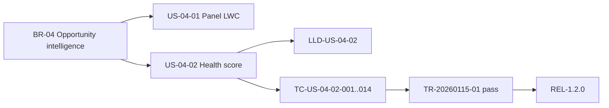

# Requirements Traceability Matrix (RTM)

Build the RTM from IDs only; never re-derive requirements. Save to `docs/sdlc/04-qa/rtm.md`
(under `paths.docs` from the project config, or wherever the user asks). Read every value from
the artifacts on disk: a result, defect or release that is not recorded in a file does not exist.

## Forward trace (requirement -> delivery -> verification -> release)

| BR | FR / RULE | Story | AC | LLD | Test cases | Last run (result) | Defects | Release | Status |
|---|---|---|---|---|---|---|---|---|---|
| BR-04 | FR-04.2 | US-04-02 | AC-1..AC-6 | LLD-US-04-02 | TC-US-04-02-001..014 | TR-20260115-01 (14/14 pass) | DEF-003 (closed) | REL-1.2.0 | Released |
| BR-04 | FR-04.3 | US-04-03 | AC-1..AC-5 | LLD-US-04-03 | TC-US-04-03-001..009 | TR-20260115-01 (7/9 pass) | DEF-004 (open, Major) | — | **Failed: re-test pending** |
| BR-04 | FR-04.5 | US-04-05 | AC-1..AC-4 | LLD-US-04-05 | — | — | — | — | **Gap: no tests** |
| BR-05 | FR-05.3 | — | — | — | — | — | — | — | **Gap: no story** |

Column sources:
- **Last run (result)**: the most recent `TR-…` that executed the story's cases, with
  passed/executed counts. Take it from `docs/sdlc/04-qa/test-runs/`. A case not executed in that
  run counts as not run.
- **Defects**: every `DEF-nnn` linked to the story, with status and, when open, severity.
- **Release**: the `REL-<version>` whose readiness report lists the story; `—` until then.

Status values, in the order a story moves through them:
`Gap: no story`, `Gap: no design`, `Gap: no tests`, `Designed` (tests written, never run),
`Partial` (some ACs have no test or were not run), `Failed: re-test pending` (a failed case or an
open defect), `Verified` (every AC has a passing case in the last run and no open defect above
the release threshold), `Released`, `Deferred` (with the decision reference).

A story is `Verified` only when the passing run is cited. "Tests exist" is `Designed`.

## Backward trace (find scope creep)

| Item | Upstream ID | Verdict |
|---|---|---|
| US-03-06 | — | Technical enabler: permission set group (allowed) |
| US-04-07 | — | **No source requirement: confirm with PO** |
| DEF-006 | — | **No linked test case: add a TC so the fix is re-testable** |

## Coverage summary

```text
BRs: 5   with stories: 5 (100%)
FRs: 21  with stories: 20 (95%)   missing: FR-05.3
Stories: 18  with LLD: 12 (67%)  with tests: 15 (83%)
ACs: 104  with at least one test case: 97 (93%)  passing in the last run: 88 (85%)
Test cases: 212  executed: 190  passed: 181  failed: 6  blocked: 3  not run: 22
Defects: 9  open: 2 (Blocker 0, Major 1, Minor 1)  closed with a cited passing run: 7
Releases: REL-1.2.0 (12 stories)  not yet in a release: 6 stories
Open questions affecting scope: Q-02, Q-05
```

## Mermaid view (optional, small scopes only)

Use only when there are fewer than ~25 nodes; large graphs do not render legibly.


