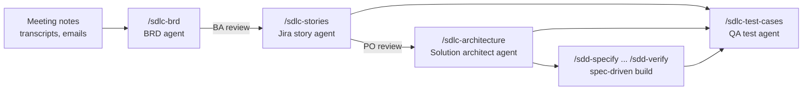

# Salesforce SDLC Skills & Agents

A ready-made AI harness for Salesforce projects. Copy one folder into your project and your coding
agent (**Claude Code**, **GitHub Copilot** or **Cursor**) works like a Salesforce team member: it
follows Salesforce coding rules, uses 165 Salesforce skills, runs four SDLC agents
(BRD → Jira stories → solution architecture → QA test cases), and builds features with
spec-driven development.

| Your tool | Copy this folder into your project root | What it loads |
|---|---|---|
| Claude Code | `.claude/` | `CLAUDE.md`, `rules/`, `agents/`, `commands/`, `skills/`, `SDLC_Skill_library/` |
| GitHub Copilot (VS Code) | `.github/` | `copilot-instructions.md`, `instructions/`, `agents/`, `prompts/`, `skills/`, `SDLC_Skill_library/` |
| Cursor | `.cursor/` | `rules/`, `agents/`, `commands/`, `skills/`, `SDLC_Skill_library/` |

All three folders contain the same content in each tool's native format. `skills/` holds the
Salesforce skills; `SDLC_Skill_library/` holds the custom Nagarro SDLC skills (a copy of each is
also placed in `skills/`, because the tools only load skills from there).

---

## Quick start

```bash
git clone <this-repo-url> sf-skills-agents

cd /path/to/your-salesforce-project
cp -r ../sf-skills-agents/.cursor .     # or .claude, or .github: only the one you use
git add .cursor && git commit -m "Add Salesforce AI harness"
```

If your project already has a `.github/` folder (workflows, templates), copy the contents instead of
replacing the folder:

```bash
cp -r ../sf-skills-agents/.github/. .github/
```

Then open the project and try:

```text
/sdlc-brd docs/sdlc/00-inputs/
/sdd-specify US-04-02
```

Requirements: the [Salesforce CLI](https://developer.salesforce.com/tools/salesforcecli) (`sf`)
for org-facing skills; Node.js for LWC Jest tests.

---

## The SDLC pipeline



| Command | Agent | Produces |
|---|---|---|
| `/sdlc-brd` | `sdlc-brd-agent` | `docs/sdlc/01-brd/BRD.md`: a BABOK-aligned BRD with traceable IDs, MoSCoW priorities, source citations, open questions and an indicative Salesforce capability fit |
| `/sdlc-stories` | `sdlc-jira-story-agent` | `docs/sdlc/02-backlog/backlog.md` + `jira-import.csv`: epics, INVEST stories, Gherkin ACs, dependencies (Mermaid), estimates; creates Jira issues if a Jira MCP is connected and you approve |
| `/sdlc-architecture` | `sdlc-solution-architect-agent` | `docs/sdlc/03-architecture/`: HLD, one LLD per story, ADRs; Mermaid landscape, ERD, sequence, class, security and pipeline diagrams |
| `/sdlc-test-cases` | `sdlc-qa-test-agent` | `docs/sdlc/04-qa/`: per-story test cases (positive, negative, edge, security, bulk, integration, UI), CSV for Xray/Zephyr/TestRail, test strategy, traceability matrix |
| `/sdlc-trace` | — | Status of every stage and the BR → story → LLD → test traceability matrix with gaps |

Every agent writes a **draft** and stops for human review. IDs (`BR-04`, `FR-04.2`, `US-04-02`,
`LLD-US-04-02`, `TC-US-04-02-007`) link the artifacts, so any stage can run in a fresh session or
on a different tool.

All agents also run a **Salesforce feasibility checklist** that catches requests the platform does
not support as worded. For example, "a validation rule that warns but still saves" is impossible
(validation rules always block), and "a stored score based on today's date" goes stale because
records don't change as time passes.

## Spec-driven development

Coding agents write the right code when they are told exactly what to build. Spec-driven
development (adapted from GitHub's [Spec Kit](https://github.com/github/spec-kit)) makes that the
default for every non-trivial change:

| Command | Writes | Gate |
|---|---|---|
| `/sdd-constitution` | `specs/constitution.md` | Project engineering principles (security, bulk, tests, declarative-first), detected from your repo |
| `/sdd-specify US-04-02` | `specs/US-04-02-…/spec.md` | What and why only; unknowns marked `[NEEDS CLARIFICATION]` |
| `/sdd-clarify` | updates `spec.md` | One question at a time with options |
| `/sdd-plan` | `plan.md` | Constitution check; metadata inventory with API names; reuses the LLD |
| `/sdd-tasks` | `tasks.md` | Ordered by metadata dependency; tests before code |
| `/sdd-implement` | code + ticked tasks | Uses the matching Salesforce skill per task; checks after each |
| `/sdd-verify` | `verification.md` | Every AC with evidence; tests, coverage, Code Analyzer, security review |

An always-on rule reminds the agent to propose `/sdd-specify` before any non-trivial change.

## What's inside

| Part | Count | Source |
|---|---|---|
| Official Salesforce skills | 147 | [forcedotcom/sf-skills](https://github.com/forcedotcom/sf-skills) (Apache-2.0), pinned in `scripts/official-skills.lock` |
| Community `sf-*` skills | 18 | Apex, LWC, Flow, SOQL, security, deploy, debug and more |
| SDLC skill library (Nagarro, custom) | 6 | In `SDLC_Skill_library/`: `sdlc-workflow`, `sdlc-brd-generate`, `sdlc-jira-story-generate`, `sdlc-solution-architecture-generate`, `sdlc-qa-test-case-generate`, `sdlc-spec-driven-development` |
| SDLC agents | 4 | BRD, Jira story, solution architect, QA test |
| Commands | 12 | `/sdlc-*` and `/sdd-*` |
| Rules | 6 + project instructions | Apex, Apex tests, LWC, metadata (scoped by file type); spec-driven gate; SDLC document conventions |

Official skills by family:

| Family | Skills | Covers |
|---|---|---|
| `platform-*` | 46 | Apex, tests, objects, fields, validation rules, permission sets, sharing, SOQL, reports, metadata deploy/retrieve, docs |
| `experience-*` | 41 | LWC generation, accessibility, security, LDS/GraphQL, Experience Cloud, CMS, UI bundles (React) |
| `dx-*` | 25 | Code Analyzer, ApexGuru, DevOps Center, org and scratch-org management |
| `agentforce-*` | 8 | Agent Script authoring, testing, observability, architecture analysis |
| `omnistudio-*` | 8 | OmniScripts, FlexCards, Integration Procedures, Data Mappers, DataPacks |
| `integration-*` | 4 | Named Credentials, callouts, Connected Apps, CDC, event subscriptions |
| `automation-*`, `design-systems-*`, `mobile-*`, `commerce-*`, `data360-*`, `external-diagram-mermaid-generate` | 15 | Flow, SLDS, mobile, B2B Commerce, Data 360, Mermaid diagrams |

Industry packs (Field Service, ITSM, Omni-Channel, Education, Nonprofit, Consumer Goods, Life
Sciences, Insurance) are left out to keep the agent's context small. Add the ones a project needs to
`scripts/official-skills.txt` and run the update script.

## Project layout the agents use

```text
your-project/
├── docs/sdlc/
│   ├── 00-inputs/           meeting notes, transcripts, emails (you add these)
│   ├── 01-brd/BRD.md
│   ├── 02-backlog/          backlog.md, jira-import.csv
│   ├── 03-architecture/     HLD.md, LLD/, ADR/
│   └── 04-qa/               test-strategy.md, test-cases/, test-cases.csv, rtm.md
├── specs/
│   ├── constitution.md
│   └── US-04-02-deal-health-score/  spec.md, plan.md, tasks.md, verification.md
└── force-app/ …
```

---

## Maintaining this repository

`.claude/` is the **only source**. `.github/` and `.cursor/` are generated from it. Custom SDLC
skills are edited in `.claude/SDLC_Skill_library/`; their copies in `.claude/skills/sdlc-*` are
generated too (each has a `GENERATED.md`).

```bash
# after editing anything in .claude/
python3 scripts/sync-platforms.py

# check that generated folders are current (use in CI or a pre-commit hook)
python3 scripts/sync-platforms.py --check

# pull the latest official Salesforce skills listed in scripts/official-skills.txt
scripts/update-official-skills.sh            # or: scripts/update-official-skills.sh <tag-or-commit>
```

How each source maps:

| Source in `.claude/` | Copilot (`.github/`) | Cursor (`.cursor/`) |
|---|---|---|
| `CLAUDE.md` | `copilot-instructions.md` | `rules/00-project.mdc` (always applied) |
| `rules/*.md` (`paths:` globs) | `instructions/*.instructions.md` (`applyTo`) | `rules/*.mdc` (`globs`) |
| `agents/*.md` | `agents/*.agent.md` (with hand-off buttons between SDLC agents) | `agents/*.md` |
| `commands/*.md` | `prompts/*.prompt.md` (routed to the matching agent) | `commands/*.md` |
| `skills/<name>/` | `skills/<name>/` | `skills/<name>/` |
| `SDLC_Skill_library/<name>/` | `SDLC_Skill_library/<name>/` + copy in `skills/<name>/` | `SDLC_Skill_library/<name>/` + copy in `skills/<name>/` |

Adding things:
- **Skill**: custom skills go in `.claude/SDLC_Skill_library/<name>/SKILL.md`; official/community
  Salesforce skills in `.claude/skills/<name>/SKILL.md`. Either way, `name` must equal the folder name, with a
  `description` of at most 1,024 characters. Copilot and Cursor silently skip skills that break
  either rule; the sync script warns about both.
- **Agent**: `.claude/agents/<name>.md` with `name`, `description`, optional `tools`, `model`,
  `skills`. Leave `tools` out if the agent needs MCP tools (for example Jira).
- **Command**: `.claude/commands/<name>.md` with `description`, `argument-hint`, `$ARGUMENTS`.
  Start the body with `Use the **<agent>** subagent to …` to route it to an agent on every tool.
- **Rule**: `.claude/rules/<name>.md` with `description` and optional `paths:` globs (no `paths`
  means always on). Keep always-on rules short; they cost context in every session.

Known upstream issue: three official skills (`automation-sandbox-post-copy-config-generate`,
`automation-sandbox-post-copy-configure`, `experience-cms-content-generate`) have descriptions a few
characters over 1,024, so Copilot may not load them.

## Salesforce DX MCP server

The Salesforce DX MCP server (`@salesforce/mcp`) reaches end of life on 2 November 2026; Salesforce
now delivers that tooling as the skills included here. The kit therefore ships no MCP
configuration. To let the Jira story agent create issues directly, connect an Atlassian/Jira MCP
server in your tool. Otherwise it produces a CSV for import.

## Credits and licences

- Official skills: © Salesforce, Inc., Apache-2.0 (`.claude/skills/LICENSE-forcedotcom-sf-skills.txt`).
- Spec-driven development method adapted from GitHub Spec Kit, MIT.
- SDLC skills, agents, commands and rules: Nagarro Salesforce CoE.
