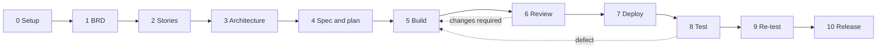

# Salesforce SDLC kit for Claude Code

A ready-made Claude Code environment for Salesforce delivery teams: developers, business analysts
and managers. It takes work from raw meeting transcripts to a production release, with Salesforce
practice built into every step.

**BRD → Jira stories → architecture and plan → development → code verification → deployment →
QA testing → re-test → release.**

| What you get | |
|---|---|
| 10 agents | BRD, Jira stories, solution architect, planner, developer, code reviewer, QA, deployment, release manager, project scout |
| 22 commands | One per lifecycle step, each stopping for human review |
| 11 SDLC skills | The method, templates and checklists behind each step |
| 174 Salesforce skills | A library; setup installs only the ones your project needs |
| Guard hooks | Production-org guard, secret guard, branch guard, commit gate, write-time source checks, failure triage, audit log |
| `sf-sdlc` CLI | Tool checks, config, skill installer, official Salesforce Code Analyzer, change delta, validated deploys, test runs |
| Plugin extras | 3 workflows, 2 monitors, 2 output styles, 2 themes, Atlassian (Jira) connection |

Install and configure: **[SETUP.md](SETUP.md)**. Research and sources: [RESEARCH.md](RESEARCH.md).
Interactive guide to the plugin structure: **[docs/index.html](docs/index.html)** (open it in a
browser, or publish `docs/` with GitHub Pages).

## Install in one minute

```text
/plugin marketplace add nagarroARBsf/Sf-skills-agents
/plugin install sf-sdlc@nagarro-sf
/sf-sdlc:setup
```

Or copy the `.claude/` folder into your project and run `/sdlc-setup`. Command names below are the
plugin's; with the copied folder use `/sdlc-<name>` for lifecycle commands and `/sdd-<name>` for the
build phase (`/sf-sdlc:plan` is `/sdd-plan`, `/sf-sdlc:brd` is `/sdlc-brd`).

## What goes in the plugin

The plugin has nearly every kind of Claude Code plugin component, each in its default folder.
Claude Code discovers them automatically. What you provide lives in **your** project, not in the
plugin (see [What you configure](#what-you-configure)).

```text
plugins/sf-sdlc/
├── .claude-plugin/
│   └── plugin.json              manifest: name, version, per-user options (hook mode, audit log)
├── skills/                      11 sdlc-* method skills + salesforce-coding-rules   (loaded when relevant)
│   └── sdlc-code-review/
│       ├── SKILL.md             frontmatter (name, when to trigger) + the method
│       └── references/          templates and checklists, loaded only when needed
├── skill-library/               174 Salesforce skills, never loaded from here; installed per project
├── commands/                    22 slash commands: /sf-sdlc:brd, /sf-sdlc:plan, /sf-sdlc:deploy …
│   └── deploy.md
├── agents/                      10 subagents, one per lifecycle stage
│   └── sdlc-code-review-agent.md
├── hooks/
│   ├── hooks.json               wires Claude Code events to run.js
│   └── run.js, lib.js, ops.js, checks.js   production-org, secret, branch and commit guards
├── monitors/
│   └── monitors.json            deploy-watch, test-watch: report when a background job finishes
├── output-styles/               Salesforce Delivery Lead (plain English), Salesforce Engineer (terse)
├── themes/                      SF SDLC Dark, SF SDLC Light
├── workflows/                   parallel review, story fan-out, release readiness
├── bin/sf-sdlc                  the kit's CLI, on the PATH inside Claude Code
├── catalog/                     skill catalog and the detection rules setup uses to recommend skills
├── context/                     project instructions printed at session start
├── templates/                   files `sf-sdlc init` writes into your project
├── .mcp.json                    Atlassian remote MCP server (Jira, Confluence)
├── README.md
└── NOTICE
```

| Piece | What it is for | What you provide | How you use it |
|---|---|---|---|
| `.claude-plugin/plugin.json` | Manifest and per-user options | Nothing. Maintainers bump `version` per release | `/plugin configure sf-sdlc@nagarro-sf` to set Hook mode and Audit log for yourself |
| `skills/` | The method behind each stage: templates, checklists, ID scheme | Nothing | Automatic: Claude loads a skill when its description matches; agents preload theirs |
| `skill-library/` | Salesforce technical skills (Apex, LWC, Flow, objects, deploy …) | Choose which ones the project gets | `/sf-sdlc:skills` or `sf-sdlc skills recommend` → `install`; copied to your `.claude/skills/` |
| `commands/` | One command per lifecycle step; each routes to an agent | Arguments: files, a story ID, an org | `/sf-sdlc:brd notes/`, `/sf-sdlc:specify US-04-02`, `/sf-sdlc:deploy qa` |
| `agents/` | Stage specialists with their own tools and skills; each writes a draft and stops | Nothing; they read your project config | Started by commands, or by name ("use the sdlc-plan-agent …") |
| `hooks/` | Guards around every shell command and file write; session facts; audit log | `orgs.production`, `git.protectedBranches`, `hooks.mode` | Nothing to run. Start in `observe`, switch to `enforce` |
| `monitors/` | Tell Claude when a deploy or async test run changes state | Nothing (experimental; not in headless sessions) | Start `/sf-sdlc:deploy uat` and keep working |
| `output-styles/` | Tone for the reader: business or engineering | Pick one per person | `/output-style` → Salesforce Delivery Lead or Salesforce Engineer |
| `themes/` | Terminal colours | Nothing (experimental) | `/theme` |
| `workflows/` | Several agents in parallel, then combined | Nothing; depends on your Claude plan | "run the sdlc-release-readiness workflow for 1.4.0" |
| `bin/sf-sdlc` | Deterministic work: doctor, config, delta, skills, Code Analyzer, deploy, test | Node.js 18+; `sf` CLI for org work | `sf-sdlc doctor`, `sf-sdlc analyze --staged`, `sf-sdlc delta --from main` |
| `.mcp.json` | Jira and Confluence through Atlassian's remote MCP | Sign in once with `/mcp`; `jira.*` keys in config | Stories, bugs, fix versions; always previewed, created only after a yes |

Example: a command (`commands/deploy.md`) hands off to an agent and can only be started by a person.

```markdown
---
description: Validate, then deploy to a named org through the Salesforce CLI, with a deployment record and rollback plan
argument-hint: "<org role or alias: qa | uat | production | alias> [validate | quick | status]"
disable-model-invocation: true
---
Use the **sdlc-deployment-agent** subagent to run the deployment.

Target and scope from the user: $ARGUMENTS
```

Example: the reviewer agent (`agents/sdlc-code-review-agent.md`) has no `Write` or `Edit` tool, so it
cannot change the code it reviews.

```markdown
---
name: sdlc-code-review-agent
tools: Read, Glob, Grep, Bash
model: inherit
skills: sdlc-code-review, sdlc-workflow
---
```

Example: a monitor (`monitors/monitors.json`) reports when a deployment changes state.

```json
{
  "name": "deploy-watch",
  "command": "node \"${CLAUDE_PLUGIN_ROOT}/bin/sf-sdlc\" jobs watch --type deploy",
  "when": "on-skill-invoke:sdlc-deploy-release"
}
```

### What you configure

The plugin ships no project-specific values. `/sf-sdlc:setup` (or `sf-sdlc init`) creates these in
your Salesforce project and never overwrites an existing file:

```text
your-salesforce-project/
├── .claude/
│   ├── sf-sdlc.json               org aliases (which are production), branches, Jira, coverage, pipeline   commit
│   ├── sf-sdlc.local.json         personal overrides, e.g. your scratch org                                 do not commit
│   ├── settings.json              Claude Code permissions: allow / ask / deny                              commit
│   ├── sf-sdlc.skills.lock.json   installed skills and their hashes                                       commit
│   └── skills/                    only the Salesforce skills this project needs                            commit
├── code-analyzer.yml              Code Analyzer rules                                                      commit
├── docs/sdlc/                     BRD, backlog, architecture, QA and release drafts
├── specs/                         constitution.md and one folder per story: spec, plan, tasks, review
└── .sf-sdlc/                      audit log, tracked jobs, caches                                          ignored
```

The one setting you must get right is `orgs.production`: list every production alias there.

```json
{
  "orgs":   { "dev": "orion-dev", "qa": "orion-qa", "uat": "orion-uat", "production": ["orion-prod"] },
  "git":    { "mainBranch": "main", "protectedBranches": ["main", "develop", "release/*"] },
  "jira":   { "enabled": true, "site": "https://acme.atlassian.net", "projectKey": "ORION" },
  "quality":{ "coverageTarget": 85, "analyzerSeverityThreshold": 2 },
  "deploy": { "pipeline": ["dev", "qa", "uat", "production"], "allowDirectProductionDeploy": false },
  "hooks":  { "mode": "observe", "auditLog": true }
}
```

Full example: [`.claude/templates/sf-sdlc.example.json`](.claude/templates/sf-sdlc.example.json).
Every key: [SETUP.md](SETUP.md#41-claudesf-sdlcjson--the-main-project-config-commit-it).

## The lifecycle



Every step writes a draft and stops. A person reviews it and fills in its approval record before the
next step starts. Agents never approve their own work.

| # | Step | Who usually runs it | Command | Agent | Output |
|---|---|---|---|---|---|
| 0 | Set up the project | Tech lead | `/sf-sdlc:setup`, `/sf-sdlc:doctor`, `/sf-sdlc:skills` | project scout | `.claude/sf-sdlc.json`, installed skills, baseline inventory |
| 1 | Requirements from transcripts | Business analyst | `/sf-sdlc:brd <files>` | BRD | `docs/sdlc/01-brd/BRD.md` |
| 2 | Epics and stories | Product owner | `/sf-sdlc:stories` | Jira story | `docs/sdlc/02-backlog/`, Jira issues after you say yes |
| 3 | Architecture and diagrams | Architect | `/sf-sdlc:architecture`, `/sf-sdlc:diagram` | solution architect | HLD, per-story LLD, ADRs, diagrams marking New / Changed / Unchanged |
| 4 | Spec and plan | Developer | `/sf-sdlc:constitution` (once), `/sf-sdlc:specify`, `/sf-sdlc:clarify`, `/sf-sdlc:plan`, `/sf-sdlc:tasks` | planner | `specs/<story>/spec.md`, `plan.md`, `tasks.md` |
| 5 | Build | Developer | `/sf-sdlc:implement`, `/sf-sdlc:verify` | developer | Apex, LWC, Flow, metadata, tests; evidence per task |
| 6 | Code verification | Reviewer | `/sf-sdlc:review`, `/sf-sdlc:analyze` | code reviewer (read-only) | `specs/<story>/review.md` with a verdict |
| 7 | Deployment | Release engineer | `/sf-sdlc:deploy <org>` | deployment | Validation, then quick deploy; `DEP-nnn.md` with rollback plan |
| 8 | QA testing | QA | `/sf-sdlc:test-cases`, `/sf-sdlc:test-run <org>` | QA | Test cases, `TR-*` run reports, `DEF-nnn` defects |
| 9 | Re-test | QA | `/sf-sdlc:retest` | QA | Updated defect and test status, with the passing run cited |
| 10 | Release | Release manager | `/sf-sdlc:release <version>` | release manager | Readiness report, release notes, Jira version and GitHub release after you say yes |
| — | Status at any time | Anyone | `/sf-sdlc:trace` | — | Where things stand, what is blocked, traceability matrix |

Traceability runs through one ID chain:
`BR-04` → `FR-04.2` → `US-04-02` → `LLD-US-04-02` → `TC-US-04-02-007` → `TR-…` → `DEF-012` → `DEP-005` → `REL-1.4.0`.

### Walk-through

```text
/sf-sdlc:setup                          # once per project
/sf-sdlc:brd docs/sdlc/00-inputs/       # transcripts in, BRD draft out   → BA reviews and signs
/sf-sdlc:stories                        # backlog and Jira CSV            → PO reviews; "yes" creates Jira issues
/sf-sdlc:architecture                   # HLD; then: /sf-sdlc:architecture US-04-02
/sf-sdlc:diagram solution US-04-02      # what is new, changed, unchanged
/sf-sdlc:specify US-04-02               # then clarify → plan → tasks, each reviewed
/sf-sdlc:implement                      # tests first, task by task
/sf-sdlc:verify                         # evidence for each acceptance criterion
/sf-sdlc:review US-04-02                # independent review and Code Analyzer
/sf-sdlc:deploy qa                      # validate, then quick deploy
/sf-sdlc:test-run qa US-04-02           # run tests, report coverage, log defects
/sf-sdlc:retest DEF-012                 # after the fix
/sf-sdlc:deploy production              # only when you name it; asks you again
/sf-sdlc:release 1.4.0                  # readiness, notes, close-out
```

### For business analysts and managers

You do not need the Salesforce CLI or an org. Steps 1, 2, test design in step 8, `/sf-sdlc:trace` and
the readiness report work from documents alone. Switch on the plain-English style with
`/output-style` → **Salesforce Delivery Lead**. Without a Jira connection the story agent writes a
CSV you can import.

## Safety model

| Guard | What it does | Can be relaxed? |
|---|---|---|
| Production-org guard | Classifies the target of every org-changing `sf` command. Production: denies `NoTestRun` and direct deploys (validate, then quick deploy), and asks you to confirm everything else. An org it cannot classify also needs your confirmation | Policy via `deploy.allowDirectProductionDeploy`; the guard itself stays on in every hook mode |
| Secret guard | Blocks writing or committing CLI auth URLs, private keys, access tokens, and anything under `.sf/` or `.sfdx/` | No |
| Branch guard | Blocks pushes to protected branches; force-pushes to them are always blocked | `hooks.mode` |
| Commit gate | Runs the official Salesforce Code Analyzer on the files being committed | `hooks.mode`, `quality.analyzerSeverityThreshold` |
| Source check | After each edit, flags SOQL or DML in loops, missing sharing, hard-coded IDs, `SeeAllData`, API version drift | Advisory only |
| Permission rules | Deploys, deletions, data changes, pushes and releases always prompt, even if a hook cannot run | `.claude/settings.json` |
| Audit log | Records who ran which org-affecting command against which org | `hooks.auditLog` |
| Person-only commands | `deploy` and `release` cannot be started by Claude on its own | No |

New installs start in `observe` mode: advisory guards report what they would block. Switch
`hooks.mode` to `enforce` once the team has seen them.

## Skills: only what the project needs

No Salesforce technical skill is loaded by default, because every loaded skill costs context in every
session. `/sf-sdlc:skills` reads the project (metadata folders, `sfdx-project.json`, tooling),
recommends skills with the evidence for each, and installs the ones you confirm into the project's
`.claude/skills/`. A lock file tracks them; `sf-sdlc skills sync` updates them after an upgrade and
never overwrites a skill you edited. Starter sets: `--profile developer`, `admin`, or `ba` (none).

## Components and where they live

`.claude/` is the source of truth. `plugins/sf-sdlc/` is generated from it by
`python3 scripts/build-claude-plugin.py`.

| Component | Copy-in `.claude/` | Plugin |
|---|---|---|
| Agents, commands, SDLC skills, skill library | Yes | Yes |
| Hooks | Yes, through `settings.json` | Yes, `hooks/hooks.json` |
| `sf-sdlc` CLI | `node .claude/bin/sf-sdlc` | `sf-sdlc` on the PATH |
| Output styles, workflows | Yes | Yes |
| Project instructions and coding rules | `CLAUDE.md`, `rules/` | Injected at session start; rules as the `salesforce-coding-rules` skill |
| Monitors, themes, Jira connection, per-user options | No (plugin-only features of Claude Code) | Yes |

## Known limitations

- **Not yet run against a real org or Jira project.** The hooks, config, skill installer, change
  delta and Code Analyzer integration are covered by unit tests and were run locally. The deploy,
  test-run and job-monitor paths, and Jira issue creation, have not been exercised end to end. Prove
  them in a sandbox before relying on them.
- **No behavioural evaluation suite.** The agents and skills have not been scored with
  `claude plugin eval`; their quality is unmeasured.
- **Monitors and themes are experimental features of Claude Code** and may need changes when their
  format moves. Monitors do not run in headless (`claude -p`) sessions.
- **Workflows depend on your Claude plan and provider** and can be disabled by an administrator.
  Each has a plain command that does the same job without parallelism.
- **No Salesforce MCP server is included.** All Salesforce work goes through the `sf` CLI. The
  official `automation-flow-generate`, `platform-flexipage-generate` and three related library
  skills expect Salesforce's Metadata Experts MCP tool and will not work without it; setup
  recommends the CLI-only `sf-flow` skill for Flows instead.
- **Source checks are heuristics.** They catch common mistakes quickly and can be wrong in both
  directions. The Code Analyzer is the authoritative scan.
- **Org classification relies on the CLI's org list and your config.** List every production alias
  in `orgs.production`. A production org that is not listed and not authenticated is treated as
  unknown, which asks for confirmation rather than blocking.
- **The audit log is a local, editable file**, not a tamper-proof record. Ship it to your own
  logging system if you need that.
- **Windows without WSL:** hooks run where Git Bash is available; the `sf-sdlc` shortcut does not,
  so use `node <path>/bin/sf-sdlc`.
- **claude.ai and Cowork** do not install plugins that contain executables. This kit targets Claude Code.
- **Jira and Confluence do not render Mermaid.** Attach the SVG from `sf-sdlc diagram render`
  (needs mermaid-cli).
- **Hooks and permission rules guide an agent; they are not a security boundary.** Org permissions,
  branch protection in your Git host, and CI remain the real controls.
- **GitHub Copilot and Cursor:** the `.github/` and `.cursor/` folders in this repository are from
  the previous release and have not been regenerated for this one.
- Three upstream skill descriptions exceed 1,024 characters and are truncated in listings.

## Maintaining this repository

```bash
python3 scripts/build-claude-plugin.py          # regenerate the plugin and the skill catalog
python3 scripts/build-claude-plugin.py --check  # fail if anything generated is stale
node --test tests/kit.test.js                   # hook and CLI unit tests
claude plugin validate plugins/sf-sdlc --strict
scripts/update-official-skills.sh --no-sync     # re-vendor official skills from upstream
```

Bump `version` in `plugins/sf-sdlc/.claude-plugin/plugin.json` on every release, or installed copies
will not update.

## Credits and licences

Official skills are vendored unmodified from
[forcedotcom/sf-skills](https://github.com/forcedotcom/sf-skills) (Apache-2.0). The `sf-*` skills
come from [Clientell-Ai/salesforce-skills](https://github.com/Clientell-Ai/salesforce-skills)
(Apache-2.0). Spec-driven development is adapted from
[github/spec-kit](https://github.com/github/spec-kit) (MIT). See [NOTICE](NOTICE). This kit is not
affiliated with or endorsed by Salesforce, Atlassian or GitHub.
