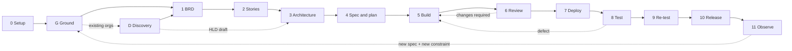

# Salesforce SDLC kit for Claude Code — Enterprise Edition (3.1)

A ready-made Claude Code environment for Salesforce delivery teams: developers, business analysts
and managers. It takes work from raw meeting transcripts to a production release, with Salesforce
practice built into every step.

**Ground → discovery of existing orgs → BRD → Jira stories → architecture and plan → development → code verification →
deployment → QA testing → re-test → release → observe.**

| What you get | |
|---|---|
| Spec-driven development | Spec → plan → tasks → tests first → verify, in the main conversation; plan mode follows the same 12-section plan format |
| 5 agents | Discovery and design (existing orgs: discovery pack checked against the org, org comparison, fit-gap, HLD draft; read-only), BRD analyst, solution architect, code reviewer (Code Analyzer plus the coding rules, read-only and independent of the author), QA (test design, test runs, browser UI tests). Planning and development use your coding agent's own plan mode and editing, in the spec-driven format |
| 24 commands | One per lifecycle step, each stopping for human review |
| 12 skills always available | The method behind each stage (`sdlc-*`), plus `sf-sdlc-setup` for the kit itself |
| 7 coding rule files | Apex, Apex tests, LWC, Flow, metadata, SDLC documents, spec-driven development — from Salesforce docs, Code Analyzer rules and Salesforce's own skills |
| Your own templates | Jira process (Scrum, Kanban, SAFe or your own), story, BRD, LLD, test and release templates in your project replace the kit's |
| 177 Salesforce and diagram skills | A library; setup installs only the ones your project needs |
| Hosted MCP servers | Salesforce's Metadata Grounding and Metadata Experts servers (Headless 360 and Data 360 optional), signed in through your `sf` CLI login: no client ID, secret or token to store |
| Guard hooks | Production-org guard, secret guard, branch guard, commit gate, write-time source checks, failure triage, audit log |
| `sf-sdlc` CLI | Tool checks, config, skill installer, read-only org discovery snapshots and org-to-org comparison, official Salesforce Code Analyzer, change delta, validated deploys, test runs |
| Plugin extras | 3 workflows, 2 monitors, 3 output styles (Business Analyst, Developer, Manager), 2 themes, Atlassian (Jira) connection |

Install and configure: **[SETUP.md](SETUP.md)**. Research and sources: [RESEARCH.md](RESEARCH.md).
Interactive guide to the plugin structure: the website in **[website/](website/README.md)**
(build it with `python3 scripts/build-site.py`, then open `site/index.html`).

## What changed in 3.1

One new agent for existing orgs. **`sdlc-discovery-design-agent`** (`/sf-sdlc:discovery`, copy-in
`/sdlc-discovery`) goes into one or more existing orgs, read-only, and checks the discovery pack
(workshop notes, call transcripts, current-state documents) against what the orgs really contain.
Every statement gets a verdict — confirmed, partly holds, contradicted, stale or not verifiable — with
the evidence. For an org merge or harmonization it compares the orgs and records a keep, bring, merge
or retire decision per component. It then drafts the current-state assessment, the fit-gap (fit to
standard first, declarative before code) and the HLD, which the solution architect continues.

- New skill `sdlc-discovery-fit-gap` with claim register, fit-gap, org comparison and current-state
  templates (template area `discovery`).
- New CLI command `sf-sdlc discover snapshot | summary | compare`: a fixed set of read-only metadata
  queries saved as a dated snapshot, so every finding can be traced to a file. No record data, no
  user names, no session output.
- New config key `discovery.orgs`; new IDs `CLM-nnn` (claim) and `FG-nnn` (fit-gap item); new stage
  **D** between Ground and BRD. The BRD and architecture skills read the discovery outputs when present.
- The other four agents are unchanged.

## What changed in 3.0 (Enterprise Edition)

Fewer moving parts, same method. Agents add hand-offs and context to manage, so 3.0 keeps them only
where a stage reads large inputs or produces long tool output, or where independence matters (code
review); everything else runs in the main conversation, guided by a skill and the coding rules.
Planning and development need no agent of their own: Claude Code (and Cursor and other coding
agents) already plan and edit, and the kit makes them follow the spec-driven format.

| 2.x agent | 3.0 |
|---|---|
| Project scout | `sf-sdlc-setup` skill (setup, skills, codebase baseline and grounding) |
| Jira story | `sdlc-jira-story-generate` skill, following your team's Jira process and templates |
| Planner | Plan mode and every plan request use the spec-driven 12-section plan format |
| Developer | Removed: `/sdd-implement` runs in the main conversation under the spec-driven skill and rules |
| Code reviewer | Kept, read-only: runs Code Analyzer and the kit's source checks, reviews against the coding rules in its own context; `sdlc-review-changes` workflow for a parallel pass |
| Deployment, release manager | `sdlc-deploy-release` skill; `/sdlc-deploy` and `/sdlc-release` stay person-only |
| BRD, solution architect, QA | Kept. QA now tests LWCs and any UI in a real browser (`/sdlc-ui-test`, `sdlc-ui-testing` skill) |

Also new: project templates (`paths.templates`, `sf-sdlc templates list|copy`), output styles for
business analysts, developers and managers, a Flow rule file, rewritten Apex/LWC/metadata/spec rules,
and spec-driven gates from GitHub Spec Kit (constitution check before and after design, consistency
check before code).

**Upgrading from 2.x.** Plugin users: update the plugin. Copy-in users: copy the new `.claude/` over
the old one, then run `node .claude/bin/sf-sdlc doctor` — it lists the files 3.0 removed (six agents,
`skills/sdlc-project-setup/`, two output styles) so you can delete them. If a teammate's settings name
the old output style "Salesforce Engineer" or "Salesforce Delivery Lead", pick a new one with
`/output-style`.

## Install in one minute

```bash
claude plugin marketplace add nagarroARBsf/Sf-skills-agents
claude plugin install sf-sdlc@nagarro-sf --scope project
```

Then in Claude Code (run `/reload-plugins` first if it was already open): `/sf-sdlc:setup`. Setup
does the work first — project files, skills chosen from your code, every check — and shows a
checklist of what is done, what Claude can do when you say yes, and what only you can do, with the
link for each. (`/plugin …` also works, but only in the terminal version of Claude Code.)

Or copy the `.claude/` folder into your project and run `/sdlc-setup`. Command names below are the
plugin's; with the copied folder use `/sdlc-<name>` for lifecycle commands and `/sdd-<name>` for the
build phase (`/sf-sdlc:plan` is `/sdd-plan`, `/sf-sdlc:brd` is `/sdlc-brd`).

## What goes in the plugin

The plugin has nearly every kind of Claude Code plugin component, each in its default folder.
Claude Code discovers them automatically. What you provide lives in **your** project, not in the
plugin (see [What you configure](#what-you-configure)).

```text
plugins/sf-sdlc/
├── .claude-plugin/
│   └── plugin.json              manifest: name, version, per-user options (hook mode, audit log)
├── skills/                      11 sdlc-* method skills, sf-sdlc-setup, salesforce-coding-rules   (loaded when relevant)
│   └── sdlc-code-review/
│       ├── SKILL.md             frontmatter (name, when to trigger) + the method
│       └── references/          templates and checklists, loaded only when needed
├── skill-library/               177 skills, never loaded from here; installed per project
├── commands/                    24 slash commands: /sf-sdlc:brd, /sf-sdlc:plan, /sf-sdlc:deploy …
│   └── deploy.md
├── agents/                      5 subagents: discovery and design, BRD, solution architect, code reviewer, QA
│   └── sdlc-qa-test-agent.md
├── hooks/
│   ├── hooks.json               wires Claude Code events to run.js
│   └── run.js, lib.js, ops.js, checks.js, mcp.js   org, secret, branch, commit and hosted-MCP guards
├── monitors/
│   └── monitors.json            deploy-watch, test-watch: report when a background job finishes
├── output-styles/               Salesforce Business Analyst, Salesforce Developer, Salesforce Manager
├── themes/                      SF SDLC Dark, SF SDLC Light
├── workflows/                   parallel review, story fan-out, release readiness
├── bin/sf-sdlc                  the kit's CLI, on the PATH inside Claude Code
├── bin/sf-mcp-proxy             stdio bridge to Salesforce Hosted MCP Servers through the sf CLI login
├── catalog/                     skill catalog and the detection rules setup uses to recommend skills
├── context/                     project instructions printed at session start
├── templates/                   files `sf-sdlc init` writes into your project
├── .mcp.json                    Atlassian remote MCP (Jira, Confluence) and the four sf-* hosted servers
├── README.md
└── NOTICE
```

| Piece | What it is for | What you provide | How you use it |
|---|---|---|---|
| `.claude-plugin/plugin.json` | Manifest and per-user options | Nothing. Maintainers bump `version` per release | `/plugin configure sf-sdlc@nagarro-sf` to set Hook mode and Audit log for yourself |
| `skills/` | The method behind each stage: templates, checklists, ID scheme | Optionally your own templates in `docs/sdlc/templates/` | Automatic: Claude loads a skill when its description matches; the five agents preload theirs |
| `skill-library/` | Salesforce technical skills (Apex, LWC, Flow, objects, deploy …) | Choose which ones the project gets | `/sf-sdlc:skills` or `sf-sdlc skills recommend` → `install`; copied to your `.claude/skills/` |
| `commands/` | One command per lifecycle step; most run in the main conversation with a skill, nine route to an agent | Arguments: files, a story ID, an org | `/sf-sdlc:brd notes/`, `/sf-sdlc:specify US-04-02`, `/sf-sdlc:deploy qa` |
| `agents/` | Discovery, BRD, architecture and QA (stages that read large inputs) and code review (independent of the author), kept out of the main conversation; each writes a draft and stops | Nothing; they read your project config | Started by commands, or by name ("use the sdlc-qa-test-agent to test my component …") |
| `hooks/` | Guards around every shell command and file write; session facts; audit log | `orgs.production`, `git.protectedBranches`, `hooks.mode` | Nothing to run. Start in `observe`, switch to `enforce` |
| `monitors/` | Tell Claude when a deploy or async test run changes state | Nothing (experimental; not in headless sessions) | Start `/sf-sdlc:deploy uat` and keep working |
| `output-styles/` | Tone for the reader: business analyst, developer or manager | Pick one per person | `/output-style` → Salesforce Business Analyst, Salesforce Developer or Salesforce Manager |
| `themes/` | Terminal colours | Nothing (experimental) | `/theme` |
| `workflows/` | Several agents in parallel, then combined | Nothing; depends on your Claude plan | "run the sdlc-release-readiness workflow for 1.4.0" |
| `bin/sf-sdlc` | Deterministic work: doctor, config, delta, skills, Code Analyzer, deploy, test | Node.js 18+; `sf` CLI for org work | `sf-sdlc doctor`, `sf-sdlc analyze --staged`, `sf-sdlc delta --from main` |
| `.mcp.json` | Jira and Confluence through Atlassian's remote MCP; Salesforce Hosted MCP Servers through `bin/sf-mcp-proxy` | Atlassian: sign in once with `/mcp`. Salesforce: turn the servers on in Setup → MCP Servers, `sf org login web`, `mcp.*` keys in config | Agents find existing org metadata before proposing new metadata; `sf-sdlc mcp status` shows what is connected |

Example: a command (`commands/deploy.md`) runs a skill in the main conversation and can only be
started by a person.

```markdown
---
description: Validate, then deploy to a named org through the Salesforce CLI, with a deployment record and rollback plan
argument-hint: "<org role or alias: qa | uat | production | alias> [validate | quick | status]"
disable-model-invocation: true
---
Follow Part A of the `sdlc-deploy-release` skill in this conversation.

Target and scope from the user: $ARGUMENTS
```

Example: the QA agent (`agents/sdlc-qa-test-agent.md`) preloads the skills it needs, including browser
UI testing through the Playwright MCP server.

```markdown
---
name: sdlc-qa-test-agent
model: inherit
skills: sdlc-qa-test-case-generate, sdlc-test-execution, sdlc-ui-testing, sdlc-workflow
---
```

Example: a monitor (`monitors/monitors.json`) reports when a deployment changes state.

```json
{
  "name": "deploy-watch",
  "command": "node \"${CLAUDE_PLUGIN_ROOT}/bin/sf-sdlc\" jobs watch --type deploy",
  "when": "on-skill-invoke:sdlc-deploy-release"
}
```

### What you configure

The plugin ships no project-specific values. `/sf-sdlc:setup` (or `sf-sdlc init`) creates these in
your Salesforce project and never overwrites an existing file:

```text
your-salesforce-project/
├── .claude/
│   ├── sf-sdlc.json               org aliases (which are production), branches, Jira, coverage, pipeline   commit
│   ├── sf-sdlc.local.json         personal overrides, e.g. your scratch org                                 do not commit
│   ├── settings.json              permissions, .env read-deny, plugin on at project scope                  commit
│   ├── rules/                     coding rules and sf-sdlc-kit.md (plugins cannot ship rules)              commit
│   ├── sf-sdlc.skills.lock.json   installed skills and their hashes                                       commit
│   └── skills/                    core Salesforce skills (draw.io, all platform-*) + what the code needs   commit
├── code-analyzer.yml              Code Analyzer rules                                                      commit
├── .env                           Salesforce login address/user name; Jira, Confluence, GitHub tokens       never commit
├── .env.sample                    every .env key with its explanation, no values                           commit
├── docs/sdlc/                     BRD, backlog, architecture, QA and release drafts
│   └── templates/                 optional: your own Jira process and document templates (sf-sdlc templates copy)
├── specs/                         constitution.md and one folder per story: spec, plan, tasks, review
└── .sf-sdlc/                      audit log, tracked jobs, caches, browser sign-in (browser-profile/)     ignored
```

The one setting you must get right is `orgs.production`: list every production alias there.

```json
{
  "orgs":   { "dev": "orion-dev", "qa": "orion-qa", "uat": "orion-uat", "production": ["orion-prod"] },
  "git":    { "mainBranch": "main", "protectedBranches": ["main", "develop", "release/*"] },
  "jira":   { "enabled": true, "site": "https://acme.atlassian.net", "projectKey": "ORION" },
  "quality":{ "coverageTarget": 85, "analyzerSeverityThreshold": 2 },
  "deploy": { "pipeline": ["dev", "qa", "uat", "production"], "allowDirectProductionDeploy": false },
  "hooks":  { "mode": "observe", "auditLog": true }
}
```

Full example: [`.claude/templates/sf-sdlc.example.json`](.claude/templates/sf-sdlc.example.json).
Every key: [SETUP.md](SETUP.md#41-claudesf-sdlcjson--the-main-project-config-commit-it).

## The lifecycle



Every step writes a draft and stops. A person reviews it and fills in its approval record before the
next step starts. Claude never approves its own work.

| # | Step | Who usually runs it | Command | Runs in | Output |
|---|---|---|---|---|---|
| 0 | Set up the project | Tech lead | `/sf-sdlc:setup`, `/sf-sdlc:doctor`, `/sf-sdlc:skills` | main conversation (`sf-sdlc-setup`) | `.claude/sf-sdlc.json`, installed skills, baseline inventory |
| G | Ground Claude in the business and the org | Tech lead, BA | `/sf-sdlc:setup` (drafts them) | main conversation (`sf-sdlc-setup`) | `docs/sdlc/00-grounding/ontology.yaml` (business terms → objects), `feature-map.md` (components per feature) |
| D | Discovery of existing orgs (only when orgs exist) | Architect, BA | `/sf-sdlc:discovery <orgs> <pack>` | discovery and design agent, read-only | `docs/sdlc/00-discovery/`: org snapshots, claim register (`CLM-nnn`), org comparison, current state, fit-gap (`FG-nnn`); `03-architecture/HLD.md` draft |
| 1 | Requirements from transcripts | Business analyst | `/sf-sdlc:brd <files>` | BRD agent | `docs/sdlc/01-brd/BRD.md` |
| 2 | Epics and stories | Product owner | `/sf-sdlc:stories` | main conversation (Jira skill, your Jira process) | `docs/sdlc/02-backlog/`, Jira issues after you say yes |
| 3 | Architecture and diagrams | Architect | `/sf-sdlc:architecture`, `/sf-sdlc:diagram` | solution architect agent | HLD, per-story LLD, ADRs; Salesforce-standard draw.io diagrams (PNG, SVG, PDF) marking New / Changed / Unchanged |
| 4 | Spec and plan | Developer | `/sf-sdlc:constitution` (once), `/sf-sdlc:specify`, `/sf-sdlc:clarify`, `/sf-sdlc:plan` (or plan mode), `/sf-sdlc:tasks` | main conversation (spec-driven skill) | `specs/<story>/spec.md`, `plan.md`, `tasks.md` |
| 5 | Build | Developer | `/sf-sdlc:implement`, `/sf-sdlc:verify` | main conversation (spec-driven skill + rules) | Apex, LWC, Flow, metadata, tests; evidence per task |
| 6 | Code verification | Reviewer | `/sf-sdlc:review`, `/sf-sdlc:analyze` | code review agent, read-only (Code Analyzer + coding rules) | `specs/<story>/review.md` with a verdict |
| 7 | Deployment | Release engineer | `/sf-sdlc:deploy <org>` | main conversation, person-only | Validation, then quick deploy; `DEP-nnn.md` with rollback plan |
| 8 | QA testing | QA | `/sf-sdlc:test-cases`, `/sf-sdlc:test-run <org>`, `/sf-sdlc:ui-test <component>` | QA agent | Test cases, `TR-*` run reports with browser screenshots, `DEF-nnn` defects |
| 9 | Re-test | QA | `/sf-sdlc:retest` | QA agent | Updated defect and test status, with the passing run cited |
| 10 | Release | Release manager | `/sf-sdlc:release <version>` | main conversation, person-only | Readiness report, release notes, Jira version and GitHub release after you say yes |
| 11 | Observe | QA, developer | `/sf-sdlc:test-run`, `/sf-sdlc:specify` | QA agent, main conversation | `docs/sdlc/06-observe/findings-*.md`: each finding becomes a defect or story **and** a constraint (test, Code Analyzer rule, hook) |
| — | Status at any time | Anyone | `/sf-sdlc:trace` | — | Where things stand, what is blocked, traceability matrix |

Traceability runs through one ID chain (for existing orgs it starts at `CLM-…` and `FG-…`):
`BR-04` → `FR-04.2` → `US-04-02` → `LLD-US-04-02` → `TC-US-04-02-007` → `TR-…` → `DEF-012` → `DEP-005` → `REL-1.4.0`.

### Walk-through

```text
/sf-sdlc:setup                          # once per project
/sf-sdlc:brd docs/sdlc/00-inputs/       # transcripts in, BRD draft out   → BA reviews and signs
/sf-sdlc:stories                        # backlog and Jira CSV            → PO reviews; "yes" creates Jira issues
/sf-sdlc:architecture                   # HLD; then: /sf-sdlc:architecture US-04-02
/sf-sdlc:diagram solution US-04-02      # what is new, changed, unchanged
/sf-sdlc:specify US-04-02               # then clarify → plan → tasks, each reviewed
/sf-sdlc:implement                      # tests first, task by task
/sf-sdlc:verify                         # evidence for each acceptance criterion
/sf-sdlc:review US-04-02                # read-only review and Code Analyzer (fresh session for independence)
/sf-sdlc:deploy qa                      # validate, then quick deploy
/sf-sdlc:test-run qa US-04-02           # run tests, report coverage, log defects
/sf-sdlc:ui-test accountHealthCard qa   # the component in a real browser, with screenshots
/sf-sdlc:retest DEF-012                 # after the fix
/sf-sdlc:deploy production              # only when you name it; asks you again
/sf-sdlc:release 1.4.0                  # readiness, notes, close-out
```

### For business analysts and managers

You do not need the Salesforce CLI or an org. Steps 1, 2, test design in step 8, `/sf-sdlc:trace` and
the readiness report work from documents alone. Pick the style that fits you with `/output-style`:
**Salesforce Business Analyst** (requirements, stories and acceptance criteria in business language),
**Salesforce Manager** (status, risks and decisions on one screen, no technical detail) or
**Salesforce Developer** (terse, with file and line evidence). Without a Jira connection the stories
step writes a CSV you can import. Teams with their own Jira process (SAFe, Kanban, a client standard)
run `sf-sdlc templates copy jira`, edit the copies in `docs/sdlc/templates/jira/`, and stories follow them.

## Safety model

| Guard | What it does | Can be relaxed? |
|---|---|---|
| Production-org guard | Classifies the target of every org-changing `sf` command. Production: denies `NoTestRun` and direct deploys (validate, then quick deploy), and asks you to confirm everything else. An org it cannot classify also needs your confirmation | Policy via `deploy.allowDirectProductionDeploy`; the guard itself stays on in every hook mode |
| Secret guard | Blocks writing or committing CLI auth URLs, private keys, access tokens, and anything under `.sf/` or `.sfdx/` | No |
| Branch guard | Blocks pushes to protected branches; force-pushes to them are always blocked | `hooks.mode` |
| Commit gate | Runs the official Salesforce Code Analyzer on the files being committed | `hooks.mode`, `quality.analyzerSeverityThreshold` |
| Source check | After each edit, flags SOQL or DML in loops, missing sharing, hard-coded IDs, `SeeAllData`, API version drift | Advisory only |
| Permission rules | Deploys, deletions, data changes, pushes and releases always prompt, even if a hook cannot run | `.claude/settings.json` |
| Audit log | Records who ran which org-affecting command against which org | `hooks.auditLog` |
| Hosted MCP guard | Headless 360 `dispatch` and Data 360 `execute` can change the org: they always ask, naming the org and its class, even when the tool is allow-listed. Grounding and Metadata Experts are read-only | No |
| Person-only commands | `deploy` and `release` cannot be started by Claude on its own | No |

New installs start in `observe` mode: advisory guards report what they would block. Switch
`hooks.mode` to `enforce` once the team has seen them.

## Salesforce Hosted MCP servers

Salesforce hosts MCP servers that give an agent just the org context it needs. The kit connects
to them through `bin/sf-mcp-proxy`, a small Node.js bridge that asks the org for a short-lived
token with your existing Salesforce CLI login (`sf api request rest /ide/auth`). Nothing secret
is stored in the project or printed.

| Server (`mcp.servers`) | Default | What it gives the agents |
|---|---|---|
| `metadata-grounding` | on | Find objects, fields, flows, classes and permissions that already exist, by meaning. Needs Data 360, API access and Salesforce Catalog; not in scratch orgs; read-only |
| `metadata-experts` | on | Metadata type schemas and generation for Flows, FlexiPages, apps, tabs and sites (lets the five upstream skills that need it work) |
| `headless-360` | off | Live Setup state, settings, limits and org operations. `dispatch` changes the org and always asks |
| `data360` | off | Data 360 recipes and operations. `execute` always asks |

1. In the org: Setup → Quick Find **MCP Servers** (under API Catalog) → turn on the servers you want.
   Allow two minutes.
2. Log in once: `sf org login web --alias <alias>`. Set `mcp.org` (a role or alias) if it is not
   the default org.
3. Check: `sf-sdlc mcp status` lists each server with its tools, or the reason it is not
   connected. Restart Claude Code after changing servers.

A server that is not enabled, has no login or is switched off in the org shows up with no tools
instead of a startup error.

## Skills: only what the project needs

No Salesforce technical skill is loaded by default, because every loaded skill costs context in every
session. `/sf-sdlc:skills` reads the project (metadata folders, `sfdx-project.json`, tooling),
recommends skills with the evidence for each, and installs the ones you confirm into the project's
`.claude/skills/`. A lock file tracks them; `sf-sdlc skills sync` updates them after an upgrade and
never overwrites a skill you edited. Starter sets: `--profile developer`, `admin`, or `ba` (none).

## Components and where they live

`.claude/` is the source of truth. `plugins/sf-sdlc/` is generated from it by
`python3 scripts/build-claude-plugin.py`.

| Component | Copy-in `.claude/` | Plugin |
|---|---|---|
| Agents, commands, SDLC skills, skill library | Yes | Yes |
| Hooks | Yes, through `settings.json` | Yes, `hooks/hooks.json` |
| `sf-sdlc` CLI | `node .claude/bin/sf-sdlc` | `sf-sdlc` on the PATH |
| Output styles, workflows | Yes | Yes |
| Project instructions and coding rules | `CLAUDE.md`, `rules/` | Injected at session start; rules as the `salesforce-coding-rules` skill |
| Salesforce Hosted MCP servers | Project `.mcp.json`, written by `sf-sdlc init` | Yes, `.mcp.json` |
| Monitors, themes, Jira connection, per-user options | No (plugin-only features of Claude Code) | Yes |

## Known limitations

- **The SF-SDLC Framework is in beta.** It has not yet been tested on real customer projects, and
  it is still evolving: commands, skills, file layouts and config keys can change between releases.
  Contributions are welcome: clone the repository, make your change on a branch and raise a pull
  request against `main`.
- **3.0 is new.** Moving six stages from agents into skills, the browser UI-testing skill, project
  templates and the rewritten rules are covered by structural unit tests (files, references, CLI) and
  were not yet exercised on a customer project. The rules cite Salesforce documentation as of the
  Winter '27 release; check them against your org's API version (API 67.0 changed Apex's default
  data access to user mode).
- **The discovery snapshot has not been run against a real org.** `sf-sdlc discover` and the
  discovery agent are covered by unit tests with a simulated `sf` CLI only. Some queries (for example
  `SetupAuditTrail`, `InstalledSubscriberPackage`, `PermissionSetGroup`) depend on the edition and the
  signed-in user's permissions; a query that fails is recorded in `manifest.json` and reported, not
  hidden. Run it first against a sandbox or an org you name, and check `manifest.json`.
- **The review agent is a second opinion, not a sign-off.** `/sdlc-review` runs in its own context,
  so it does not share the author's assumptions, but it is the same model; a person still accepts the
  verdict in the approval record. A review asked for in the main conversation without the agent says
  so when that session wrote the code.
- **Not yet run against a real org or Jira project.** The hooks, config, skill installer, change
  delta and Code Analyzer integration are covered by unit tests and were run locally. The deploy,
  test-run and job-monitor paths, and Jira issue creation, have not been exercised end to end. Prove
  them in a sandbox before relying on them.
- **No behavioural evaluation suite.** The agents and skills have not been scored with
  `claude plugin eval`; their quality is unmeasured.
- **Monitors and themes are experimental features of Claude Code** and may need changes when their
  format moves. Monitors do not run in headless (`claude -p`) sessions.
- **Workflows depend on your Claude plan and provider** and can be disabled by an administrator.
  Each has a plain command that does the same job without parallelism.
- **The SObject servers (`sobject-reads`, `sobject-all`) have not been run against a real org.** They use
  the same route pattern and CLI sign-in as the other hosted servers; whether Salesforce accepts that
  sign-in for them is unverified. `sobject-reads` (read-only) is on by default and `sobject-all` is off; a server that does not answer shows as
  "no tools" with the reason. `sobject-all` tool names are not known to the kit, so every tool on it
  asks first unless its name is plainly a read (`get…`, `list…`, `describe…`, `query…`, `search…`).
- **`sf-sdlc setup --install-tools` installs only what needs no administrator password** (Salesforce CLI
  through npm, and CLI plugins). Node.js, git, Java and the GitHub CLI are listed with the command.
- **The token-based Jira/Confluence server (`atlassian-token`) has not been run against a real Jira.**
  It starts the community `mcp-atlassian` server, which is not part of this kit and is fetched by
  `uvx` (or Docker) when it starts; it is unpinned unless you set `ATLASSIAN_MCP_PACKAGE` or
  `ATLASSIAN_MCP_IMAGE` in `.env`. `sf-sdlc env gh-login` has been unit-tested only.
- **Setup's environment help gives install commands; it does not install for you unasked**, and the
  commands per operating system were written from the tools' documentation, not run on every system.
- **Hosted MCP servers are reached through a Beta route.** The proxy uses the same
  `/ide/auth` sign-in and `v1-beta.2` route as Salesforce's own Claude Code plugin; it has been
  run against one production-class org (Metadata Experts, Headless 360 and Data 360 connected;
  Metadata Grounding not yet turned on there). Salesforce may change the route. Grounding results
  can lag recent changes and are never a complete list. Setup still recommends the CLI-only
  `sf-flow` skill for Flows; the Metadata Experts skills work when that server is enabled.
- **`platform-headless-360-integrate`** refers to a version-selection helper that ships only in
  Salesforce's own plugin; read the API version from `/services/data/` instead. The upstream
  `platform-capability-search` and `platform-lsp-integrate` skills are not vendored because they
  drive that plugin's scripts.
- **Source checks are heuristics.** They catch common mistakes quickly and can be wrong in both
  directions. The Code Analyzer is the authoritative scan.
- **Org classification relies on the CLI's org list and your config.** List every production alias
  in `orgs.production`. A production org that is not listed and not authenticated is treated as
  unknown, which asks for confirmation rather than blocking.
- **The audit log is a local, editable file**, not a tamper-proof record. Ship it to your own
  logging system if you need that.
- **Windows without WSL:** hooks run where Git Bash is available; the `sf-sdlc` shortcut does not,
  so use `node <path>/bin/sf-sdlc`.
- **claude.ai and Cowork** do not install plugins that contain executables. This kit targets Claude Code.
- **Jira and Confluence do not render Mermaid.** Attach the PNG or SVG of the draw.io diagram
  (`sf-sdlc diagram export`, needs draw.io desktop), or the SVG from `sf-sdlc diagram render`
  (needs mermaid-cli).
- **Salesforce-standard diagrams follow the published conventions, not Salesforce's Lucidchart
  templates.** The draw.io generator was checked by rendering its six examples with draw.io desktop
  29 on Windows (called from WSL). Export on macOS and on Linux (`snap`, or headless with `xvfb-run`)
  has not been run. Layout is automatic: very dense diagrams can still have crossing lines or pills
  near cards, so the agent is told to look at the PNG and split or reorder. draw.io's Salesforce icon
  library has no Agentforce, Data Cloud, MuleSoft, Slack or Tableau icons; the nearest generic icon
  is used. Animated connectors move only in draw.io and SVG, not in PNG or PDF.
- **Salesforce's 25 reference diagrams (28 images) ship as picture references** in the
  architecture-diagram skill. Salesforce publishes them without a stated licence; they are included unmodified with
  attribution in `NOTICE`, for the agent to study, not to paste into client documents.
- **`drawio-skill` is vendored as published** (MIT). Its frontmatter sets `disable-model-invocation`,
  so a person starts it with `/drawio-skill`; agents read its files and run its scripts. Its scripts
  need Python 3, and its exports need draw.io desktop; `setup --install-tools` installs both only
  where no administrator password is needed (Homebrew on macOS, winget on Windows).
- **Hooks and permission rules guide an agent; they are not a security boundary.** Org permissions,
  branch protection in your Git host, and CI remain the real controls.
- **GitHub Copilot and Cursor:** the `.github/` and `.cursor/` folders in this repository are from
  the previous release and have not been regenerated for this one.
- Three upstream skill descriptions exceed 1,024 characters and are truncated in listings.
- **The mandatory core set is larger than Claude Code's skill listing budget.** Every project gets
  `drawio-skill` and all 54 official `platform-*` skills (about 18,000 description characters, against
  roughly 8,000 that Claude Code lists on a 200k-token model). Claude Code then shortens or omits some
  descriptions, so a core skill may need to be asked for by name (`/platform-…`) or loaded by an agent
  that knows it. The budget is still applied to on-demand skills. Remove a core skill a project never
  uses with `sf-sdlc skills remove <name>`; the next `setup` reinstalls it.
- **Browser testing (`sf-browser`, Playwright MCP) has been run locally, not against a Salesforce
  org.** The launcher, a headless page load and the sign-in surviving restarts were checked: setup
  sets the profile in `.sf-sdlc/browser-profile/` to restore the last session, and a session-only
  cookie (the kind Salesforce uses for its login) survived both a clean close and an abrupt stop of
  Claude Code with Chrome. A real Salesforce sign-in, Login As and Lightning waits have not been run;
  Salesforce still ends the session after the org's timeout (Setup → Session Settings). Keeping the
  sign-in works for Chrome, Edge and Chrome for Testing, is set but untested for Firefox, and is not
  available for WebKit. The server is Microsoft's `@playwright/mcp`, pinned and fetched by `npx` on first start
  (network needed once). One browser can use the profile at a time, so two Claude sessions in the same
  project cannot both drive the browser. The navigation guard only sees `browser_navigate`: a link
  clicked inside the page that leads to a production org is not stopped by it — the QA agent is told
  to stay in non-production orgs, and the profile should only ever be signed in to sandboxes. The
  profile holds live session cookies; treat the project folder accordingly.

## Maintaining this repository

```bash
python3 scripts/build-claude-plugin.py          # regenerate the plugin and the skill catalog
python3 scripts/build-claude-plugin.py --check  # fail if anything generated is stale
node --test tests/kit.test.js                   # hook and CLI unit tests
claude plugin validate plugins/sf-sdlc --strict
scripts/update-official-skills.sh --no-sync     # re-vendor official skills from upstream
```

Bump `version` in `plugins/sf-sdlc/.claude-plugin/plugin.json` on every release, or installed copies
will not update.

## Credits and licences

Official skills are vendored unmodified from
[forcedotcom/sf-skills](https://github.com/forcedotcom/sf-skills) (Apache-2.0). The `sf-*` skills
come from [Clientell-Ai/salesforce-skills](https://github.com/Clientell-Ai/salesforce-skills)
(Apache-2.0). Spec-driven development is adapted from
[github/spec-kit](https://github.com/github/spec-kit) (MIT). See [NOTICE](NOTICE). This kit is not
affiliated with or endorsed by Salesforce, Atlassian or GitHub.
