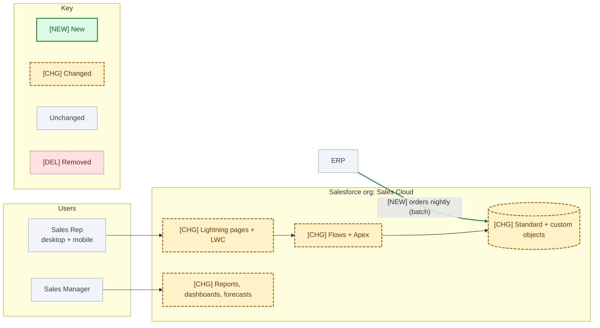
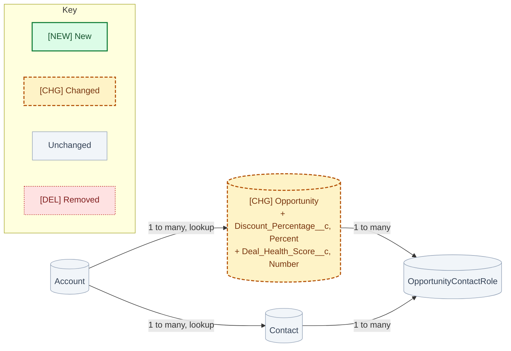
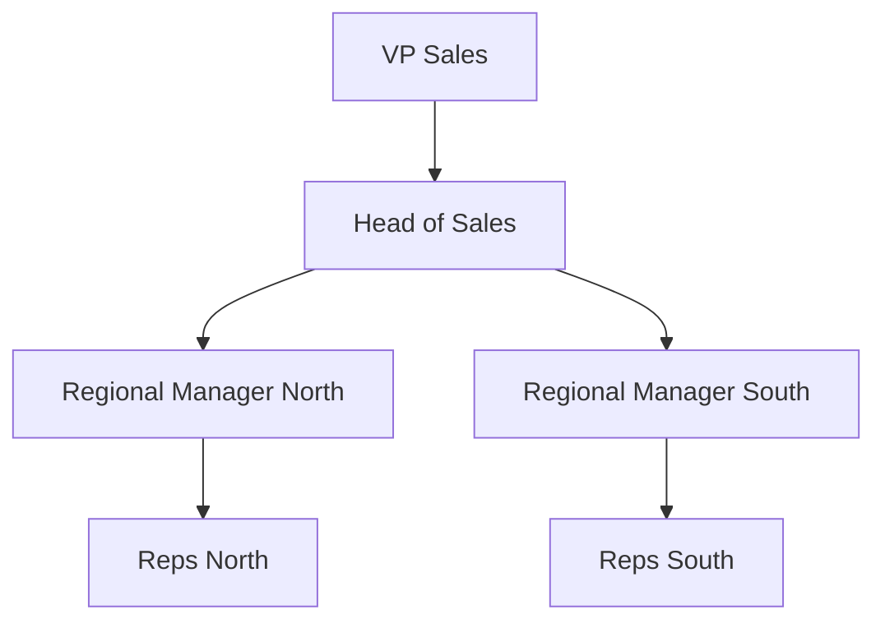
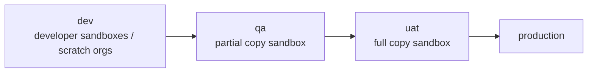

# High-Level Solution Design — {Project} {Release}

| Item | Details |
|---|---|
| Document reference | HLD-{PROJECTCODE}-{NNN} |
| Version / date | {0.1} / {YYYY-MM-DD} |
| Status | Draft for technical review |
| Inputs | BRD v{x.y}, backlog {date} |
| Baseline | {Greenfield / Brownfield} — `baseline/inventory.md` @ `{commit}` ({date}); component model `components.json` |
| Authors / reviewers | {names} |

## 1. Purpose and scope
What this design covers (BRs, epics, release) and what it does not.

**Change status.** Every component table in this document has a **Change** column with one of
`New`, `Changed`, `Unchanged`, `Removed`, copied from `components.json`. `Unchanged`
means "found in the baseline and not modified", never "assumed". Diagrams follow the
`sdlc-architecture-diagram` skill and show the same statuses.

## 2. Architecture drivers
| Driver | Source | Design implication |
|---|---|---|
| Real-time pipeline visibility | OBJ-01 | Standard reports and Collaborative Forecasts; no external BI in phase 1 |
| 500 concurrent users, page load ≤ 2 s | NFR-01/02 | Cacheable Apex, LDS, no SOQL in loops, lazy-load panels |

Constraints (`C-nn`) and assumptions (`A-nn`) that shape the design.

## 3. Architecture principles
- Standard before custom; configuration before declarative; declarative before code — unless the
  decision guide says code is the better long-term choice.
- One automation entry point per object and event (one trigger + handler; flows ordered).
- Security by default: `with sharing`, `WITH USER_MODE` / `AccessLevel.USER_MODE`, permission
  sets (not profiles) for access.
- Configuration in Custom Metadata, not hard-coded values.
- Integrations through Named Credentials and External Credentials; no secrets in code.
- Everything in source control and deployed by pipeline.
{Add client-specific principles.}

## 4. Solution overview
Narrative (one paragraph) plus the system landscape. Every diagram in this document follows the
same pattern: the Salesforce-standard image generated from its spec in `diagrams/`
(`sdlc-architecture-diagram` skill), the caption, a link to the `.drawio` source, then the Mermaid
text version.

*Caption: {the one question this diagram answers, and what is new or changed}.*
Source: [diagrams/system-landscape.drawio](diagrams/system-landscape.drawio) (spec:
`diagrams/system-landscape.diagram.json`).

Text version:

*Caption: {the one question this diagram answers, and what is new or changed}.*

## 5. Org and product footprint
| Item | Value |
|---|---|
| Edition, clouds | |
| Licences per persona | |
| Features to enable | Account Hierarchy, Path, Collaborative Forecasts, … |
| API version | {`salesforce.apiVersion` from the project config, or `sourceApiVersion` in `sfdx-project.json`} |
| Package directories | {`salesforce.packageDirectories`} |
| Namespace / component prefix | {`salesforce.namespacePrefix`} / {`salesforce.componentPrefix`} |
| Org strategy | Single org / multi-org; new / existing |

## 6. Capability map (BR → platform)
| BR / FR | Capability | Approach | Components | Change | ADR |
|---|---|---|---|---|---|
| BR-04 / FR-04.2 | Health score | Apex service + nightly batch | `OpportunityHealthService`, `OpportunityHealthBatch` | New | ADR-002 |
| BR-04 / FR-04.2 | Health score | Call from existing handler | `OpportunityTriggerHandler` | Changed | ADR-002 |
| BR-03 / FR-03.1 | Pipeline stages | Standard Path | `Opportunity` sales path | Unchanged | — |

One row per component group with the same change status.

Approach values: Standard · Configuration · Flow · Apex · LWC · Integration · AppExchange.

## 7. Data architecture
### 7.1 Data model

*Caption: {question answered; objects and fields added or changed}.* Source:
[diagrams/data-model.drawio](diagrams/data-model.drawio).

Text version: use a `flowchart` so the change status of objects, fields and relationships is visible
(template 6 in `${CLAUDE_PLUGIN_ROOT}/skills/sdlc-architecture-diagram/references/diagram-templates.md`).
Add an `erDiagram` with full attributes only when the attribute listing is needed.

*Caption: {what changes in the data model}.*
### 7.2 Object inventory
| Object | Standard / custom | Change | Purpose | Owner/sharing driver | Est. volume |
|---|---|---|---|---|---|
| `Opportunity` | Standard | Changed (2 new fields) | Deals | Owner; role hierarchy | {n} |
| `Deal_Review__c` | Custom | New | Manager review of a deal | Controlled by parent | {n} |

### 7.3 Data volumes, LDV, archiving
### 7.4 Data migration approach
Sources, sequence (users → accounts → contacts → opportunities …), tooling, de-duplication,
automation bypass during load, reconciliation.

## 8. Security and access
- OWD per object, with reason.
- Role hierarchy:

- Permission set groups per persona; custom permissions; FLS for sensitive fields.

| Persona | Permission set / group | Change | Grants |
|---|---|---|---|
| Sales Manager | `Sales_Manager_Access` | Changed | read on `Opportunity.Deal_Health_Score__c`; custom permission `View_Deal_Insights` (New) |

- Sharing rules, teams, restriction rules.
- Authentication (SSO/MFA), session settings, Shield/encryption if required.

## 9. Automation architecture
| Object | Event | Mechanism (order) | Change | Purpose | Story |
|---|---|---|---|---|---|
| Opportunity | before save | Flow `Opp_BeforeSave_Defaults` (1) | Unchanged | defaults | — |
| Opportunity | after save | Trigger → `OpportunityTriggerHandler` | Changed | score recalculation | US-04-02 |
| Opportunity | scheduled nightly | `OpportunityHealthBatch` | New | time-based factors | US-04-02 |

List **every** automation on each affected object and event, including the unchanged ones taken
from the baseline inventory (§4 there): the interplay is the risk.

Trigger framework: {existing / proposed}. Recursion control. Error handling and logging approach.

## 10. Integration architecture
| ID | System | Direction | Pattern | Mechanism | Change | Volume / frequency | Authentication | Error handling |
|---|---|---|---|---|---|---|---|---|
| INT-01 | ERP | Inbound | Batch data synchronisation | Bulk API 2.0 via middleware | New | 5k/day nightly | OAuth 2.0 client credentials, integration user with a dedicated permission set | Error object + alert |

Sequence diagram per non-trivial interface (see mermaid-patterns.md; mark new and changed
participants with the `[NEW]` / `[CHG]` prefixes).

## 11. User interface
Lightning apps, record pages, components per page; LWC component tree for custom UI; mobile.

| Page / app | Component | Type | Change | Personas | Story |
|---|---|---|---|---|---|
| `Opportunity_Record_Page` | — | FlexiPage | Changed | all sales | US-04-03 |
| `Opportunity_Record_Page` | `healthPanel` | LightningComponentBundle | New | all sales | US-04-03 |

## 12. Reporting and analytics
Report types, key reports and dashboards per persona, forecast configuration.

## 13. Non-functional design
| NFR | How the design meets it | Verification |
|---|---|---|
| NFR-01 page load | single cacheable Apex call; no SOQL in loops | QA perf test TC-… |

Governor-limit risks and mitigations.

## 14. Environments and DevOps
Draw the promotion path from `deploy.pipeline` in the project config (org roles in order), with
the org type behind each role. The example shows a four-stage pipeline.

Branching model (`git.mainBranch`, `git.integrationBranch`, `git.branchPattern`), test level per
environment (`deploy.testLevel`), validate-before-deploy and delta settings, CI checks (Code
Analyzer, Apex tests, Jest), release cadence, post-deploy manual steps register. Deployment
follows the `sdlc-deploy-release` skill.

## 15. Risks, technical debt and decisions
| ID | Item | Mitigation / decision |
|---|---|---|
| ADR-001 | {title} | {status} |

## 16. Story-to-design map
| Story | New | Changed | Removed | LLD | Notes |
|---|---|---|---|---|---|
| US-04-02 | `OpportunityHealthService`, `OpportunityHealthBatch` | `OpportunityTriggerHandler` | — | LLD-US-04-02 | ADR-002 |
| US-02-03 | — | `Account_Record_Page` | — | — | Configuration only: Account Hierarchy |

## 17. Open items
Questions for the client or tech lead, each with owner. Include every gap from the baseline
inventory (for example "org-only components not verified").

## 18. Change summary
Totals from `components.json` for this release.

| Layer | New | Changed | Unchanged (shown for context) | Removed |
|---|---|---|---|---|
| UI | | | | |
| Automation | | | | |
| Data | | | | |
| Security | | | | |
| Integration | | | | |

Removed components (each is a destructive change; see the LLD deployment notes):

| Component | Type | Replaced by | Data consequence | Story |
|---|---|---|---|---|

## Approval record
| Status | Approver | Role | Date | Comment |
|---|---|---|---|---|
| Draft for review | — | — | — | — |

Filled in by a person only.
