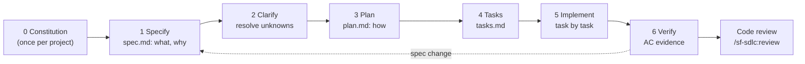

# sdlc-spec-driven-development

Coding agents write good code when they are told precisely what to build and how it must fit the
project. They write plausible but wrong code when they guess. SDD removes the guessing:



Each phase writes one file and **stops for review**. Do not run the next phase in the same turn
unless the user explicitly says so ("go through to tasks").

## When to use it
- Any Jira story, any change touching more than one metadata type, any Apex/LWC/Flow logic,
  integrations, security changes.
- Skip for trivial changes: typo, label, single field help text, formatting. Say "trivial change,
  skipping spec" and proceed.
- **Right-size it.** A small bug fix or a one-file change gets a *short spec*: the goal, the ACs
  and how each will be verified, plus section 7 only if a decision is involved — a few lines, no
  empty template sections. The full spec is for features that span several metadata types or
  several sessions. Either way, keep it to about a page.
- **Record decisions, not a description of the code**: sharing, which automation owns each field,
  volume and limits, integration timing (spec section 7). These are the decisions code cannot show.
- **Check it, don't trust it.** A spec is advice to the agent. Every requirement and AC becomes a
  test (plan §7), and the reviewer compares the spec with the code, so an unimplemented
  requirement fails a test and is flagged in review.
- The spec is **spec-anchored**: keep it current as the feature changes, so the next session and
  the next person read decisions, not chat history.

## Files

```text
specs/
├── constitution.md                    # phase 0, shared by all features
└── US-04-02-deal-health-score/        # feature folder: story ID (or NNN) + slug
    ├── spec.md                        # phase 1-2
    ├── plan.md                        # phase 3
    ├── tasks.md                       # phase 4, checked off in phase 5
    ├── verification.md                # phase 6
    └── review.md                      # written by /sf-sdlc:review (sdlc-code-review skill)
```

The root comes from `paths.specs` in the project config (default `specs`). Project values
(coverage target, branch pattern, org aliases, Jira keys) are read with
`sf-sdlc config show --json`, never typed from memory.

Folder naming: use the story ID when there is one (`US-04-02-…`); otherwise the next free
three-digit number (`007-…`). Slug: 2-5 lowercase words.

## Phase 0 — Constitution (`/sf-sdlc:constitution`)
If `specs/constitution.md` is missing, create it from
[references/constitution-template.md](references/constitution-template.md). Fill the project
facts in this order: the project config (`salesforce.*`, `quality.*`, `git.*`, `deploy.*`), then
detection (`sf-sdlc detect --json`: API version from `sfdx-project.json`,
package directories, trigger framework, test data factory, logging utility), then questions for
what neither provides. Where the config and the code disagree, say so and ask. Align with the
project's `CLAUDE.md` and `${CLAUDE_PLUGIN_ROOT}/skills/salesforce-coding-rules/references/`; exceptions to an article (for example a test class
that must use `SeeAllData=true`) are recorded in the constitution with their reason, nowhere else.

## Phase 1 — Specify (`/sf-sdlc:specify <story id | description>`)
1. Find the source: Jira story in `docs/sdlc/02-backlog/backlog.md`, a Jira key via a connected
   tool, or the user's description.
2. Create the feature folder and write `spec.md` from
   [references/spec-template.md](references/spec-template.md).
3. The spec is **what and why only**: scenarios, functional requirements, business rules, data
   (business terms), the decisions the code can't show, acceptance scenarios, success criteria,
   out of scope. No class names, no field API names, no flow names. Use the business terms from
   `00-grounding/ontology.yaml` when it exists; a term it lacks becomes a clarification and a
   proposed ontology entry.
4. Copy story ACs verbatim as the acceptance scenarios and keep their `AC-n` numbers.
5. Mark unknowns `[NEEDS CLARIFICATION: question]`. At most 5; make reasonable defaults for the
   rest and list them under Assumptions.
6. Run the spec checklist at the bottom of the template. Stop and show the open clarifications.

## Phase 2 — Clarify (`/sf-sdlc:clarify`)
Ask the user the `[NEEDS CLARIFICATION]` questions one at a time, each with 2-4 concrete options and
a recommendation. Write each answer into the spec (Clarifications section with date) and remove the
marker. Stop when none remain or the user says to proceed with the assumptions.

## Phase 3 — Plan (`/sf-sdlc:plan`)
The plan follows [references/plan-template.md](references/plan-template.md): a mandatory format
of **12 sections in a fixed order**. Do not add, drop, merge or reorder sections; a section that
does not apply keeps its heading and says why.

1. Refuse to plan while `[NEEDS CLARIFICATION]` markers remain, unless the user accepts the risk
   (record it in the plan).
2. **Discovery first.** Read the constitution, the spec, the LLD
   (`docs/sdlc/03-architecture/LLD/<story>.md`) if it exists, the grounding files
   (`docs/sdlc/00-grounding/ontology.yaml`, `feature-map.md`) when present, and every file the ticket names or
   implies, in full. Trace dependencies in both directions: who calls the code and what it
   depends on. Every `@AuraEnabled` method is public API: search for all consumers (LWC, Aura,
   flows, FlexiPages, tests) before planning a signature change. Use
   `sf-sdlc inventory --json` for what exists and, when code is already on the
   branch, `sf-sdlc delta --json`. Before planning new metadata, check the org for
   something that already does the job: the Metadata Grounding MCP tools when connected
   (`sdlc-workflow`, section Grounding), otherwise local source; say which in §4.
3. Write `plan.md` for a mixed audience (plain English first, Salesforce terms explained on
   first use, bullets and tables rather than prose), with these sections:

| § | Section | Must contain |
|---|---|---|
| 1 | Problem Statement | Two bullet lists (what is wrong today, what is being asked for) and an "In one line" summary |
| 2 | Root Cause & Current Behaviour | The mechanism, cited by `file:line` actually read |
| 3 | Functional Requirements | Numbered, atomic, testable; each maps to a test in §7 and a criterion in §8 |
| 4 | Metadata Scope | Component, Type, Change (New / Changed / Unchanged / Removed), Why |
| 5 | Technical Flow | Page → Component → Method → API parameters; one diagram per the `sdlc-architecture-diagram` skill with the change-status overlay; walkthrough; API parameter table |
| 6 | Impact Analysis | One row per component touched, affected or verified unaffected: Low / Medium / High, the consequence, the prevention |
| 7 | Unit Test Plan | Every Apex and Jest test listed before it is written; null, empty, aggregate-null, regression and bulk coverage stated; test data |
| 8 | Acceptance Criteria | Checklist the agent verifies itself, with thresholds from the project config |
| 9 | Delivery Plan | Branch, commit shape, PR base (from `git.*`), reviewer call-outs, Jira comment |
| 10 | Referenced Skills | Skills and rules actually used to write the plan |
| 11 | Close the Loop on the Ticket | The Jira comment to post after the build, shown to the user and posted only after an explicit yes |
| 12 | Development Required Skills | Installed skills in `.claude/skills/` the build will need, matched by TRIGGER text; gaps named with `/sf-sdlc:skills` |

4. If an LLD exists, cite it in §4 and §5 and record only deviations, with reasons. Do not
   re-design. Change statuses agree with `docs/sdlc/03-architecture/components.json`.
5. Check the plan against the constitution. A broken article is either fixed or stated in §6 with
   its reason and prevention.
6. Rules for the plan itself: no code (signatures, parameter tables and diagrams only); cite
   only files and lines actually read; state uncertainty as an open question, never as
   "unaffected". The plan ends with an empty approval record; implementation waits for approval.

## Phase 4 — Tasks (`/sf-sdlc:tasks`)
Write `tasks.md` from [references/tasks-template.md](references/tasks-template.md):
- One or more tasks per row of the plan's §4 Metadata Scope with Change New, Changed or Removed;
  one test task per row of §7 Unit Test Plan. Unchanged rows get no task.
- Ordered by metadata dependency: objects/fields → custom metadata/labels → permission sets →
  Apex (tests first) → triggers → flows → LWC (Jest first) → pages/layouts → data/scripts →
  destructive changes last.
- Each task: ID `T001…`, the files it touches, the plan requirement or AC it serves, `[P]` if it
  can run in parallel with the previous task (different files, no dependency).
- Test tasks precede the implementation they verify (red → green).
- Include a regression task for every Medium or High row of the plan's §6 Impact Analysis, a
  verification task per AC and a final quality-gate task.

## Phase 5 — Implement (`/sf-sdlc:implement [task range]`)
- Check the plan's approval record first. If the plan is not approved, say so and continue only
  if the user confirms.
- Work task by task in order. Before each task, re-read its line in `tasks.md` and the matching
  plan section. Use the installed skill named in the plan's §12; if it is not installed, tell
  the user to run `/sf-sdlc:skills` and continue with the project rules in `${CLAUDE_PLUGIN_ROOT}/skills/salesforce-coding-rules/references/`.
- After each task: run the narrowest useful check — the related Apex test
  (`sf-sdlc test run --org dev --tests <Class>`), the Jest test
  (`npm run test:unit -- <bundle>` when the project has it), a deploy preview or validation of
  the changed metadata against the developer's own org, `sf-sdlc analyze --changed`
  — then tick `[x]` and append a one-line note with the evidence (file paths, command, result).
  A task without evidence is not ticked.
- When the change adds, renames or removes components, update the feature's section in
  `docs/sdlc/00-grounding/feature-map.md` (if the project keeps one) in the same change.
- Stop and ask when the plan turns out wrong; update the plan (with a "Changed during
  implementation" note) before continuing. Never silently diverge from the spec.
- Deploy only to the developer's own org (`orgs.dev`, a scratch org or a developer sandbox).
  Shared orgs and production go through `/sf-sdlc:deploy`, never through this phase.

## Phase 6 — Verify (`/sf-sdlc:verify`)
Write `verification.md`:
- Each AC → evidence (test name and result, screenshot reference, or manual step outcome).
- The plan's §8 Acceptance Criteria checklist, each box ticked only with pasted real output.
- Quality gates: every test in the plan's §7 exists and passes; coverage of new and changed
  classes at or above `quality.coverageTarget`; Code Analyzer
  (`sf-sdlc analyze --changed`) with no violation at or above
  `quality.analyzerSeverityThreshold`; constitution check re-run.
- Deviations from spec/plan and their approval.
- What was not verified, and why.

Verification is the author's own check; it is not a review. **Hand off to `/sf-sdlc:review`**: the
`sdlc-code-review-agent` reviews the diff independently (correctness, security, limits, tests)
and writes `specs/<story>/review.md` with a verdict. Do not self-review in place of it, and do
not report the story as done before the review verdict is Approve (or its conditions are met).

Then: set `spec.md` status to `Implemented — pending review`; name the next steps in order —
`/sf-sdlc:review`, `/sf-sdlc:deploy` to the test org, `/sf-sdlc:test-run` against
`docs/sdlc/04-qa/test-cases/<story>.md` (or `/sf-sdlc:test-cases` first if none exist).

## Rules for every phase
- Read before write: the constitution and the previous phase's file every time.
- Keep files short and specific; delete template sections that do not apply (write "N/A — reason"
  for mandatory ones).
- One feature per folder. A scope change goes back to the spec, not straight into code.
